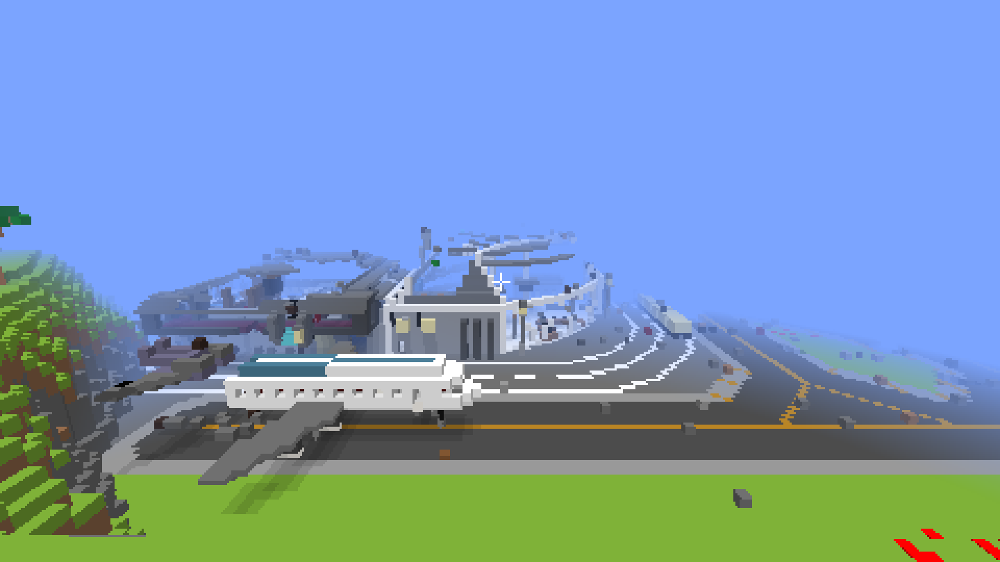
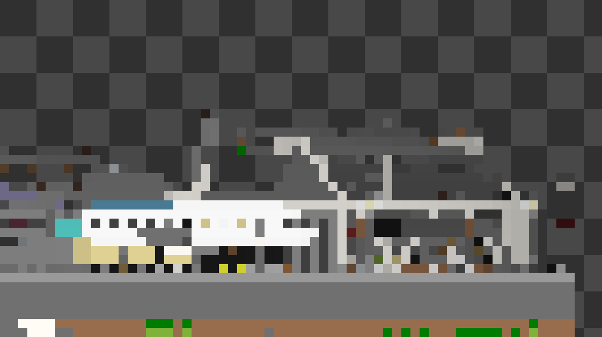

<h1 align="center">Almighty</h1>

<b>An AI game master for your Minecraft server.</b>

<a href="https://github.com/zentixua/almighty/releases/latest">Download</a> ·
<a href="docs/guide/README.md">Guide</a> ·
<a href="docs/guide/connect/README.md">Connect your agent</a> ·
<a href="https://github.com/zentixua/almighty/issues">Issues</a> ·
<a href="README.ru.md">Русский</a>

Almighty is a server-side mod that lets an AI agent you already use, such as Claude Code, Codex or the ChatGPT
desktop app, act as game master on your Minecraft server. The agent sees the world, talks to players, builds with
undo, runs events and plays with its own bot players. You decide how much of that power it uses, for whom and where;
every block it changes is recorded and can be put back.

<table>
<tr>
<td width="33%"></td>
<td width="33%"></td>
<td width="33%"></td>
</tr>
<tr>
<td>What a bot sees</td>
<td>A map of the area</td>
<td>A side view of a box</td>
</tr>
</table>

## Features

**Three layers of power.**

- **A player's body.** Bots are server players that act only through the packets a real client sends: they walk,
  mine, build, open chests, chat, ride horses and boats and fly Immersive Aircraft planes. The tab list and chat
  mark them `[bot]`.
- **An operator's hands.** Commands and functions, builds of up to millions of blocks placed a few milliseconds per
  tick, messages and titles, a live feed of chat, joins, deaths and advancements, maps and views of any place.
- **The engine itself.** Groovy scripts and rules that react to any event of the game or of another mod in the same
  tick. A rule that runs over its time budget or keeps failing turns itself off.

**It learns any modpack.** The agent reads the running server's mods, blocks, items, recipes, commands and events,
plus notes that mods, datapacks and you leave for it.

**The owner stays in charge.**

- **One permission system.** `config/almighty/policy.toml` sets who the owners are, how much each agent may do, and
  what it does unasked. Presets for a private, friends' or public server; roles from guest to owner; zones, hourly
  quotas and land claims; LuckPerms nodes. Roles are given only below one's own.
- **Requests are not orders.** A player's request runs with that player's rights. Anything that touches other
  players or cannot be undone waits for the requester's own confirmation in chat; above their rights, only the kinds
  of request you list go to an admin.
- **Recorded and reversible.** Every block the agent writes is journaled on disk, so a change can be undone even
  after a crash. Every call with an effect is in the audit log. `/almighty pause <agent>` stops that agent's builds,
  bots and rules until you resume it.
- **Safe defaults.** The bridge listens only on the server machine, every app signs in with a code you type on the
  server, and commands that crash or freeze servers are refused for every agent.

## Install

1. Put the jar for your Minecraft version and loader ([requirements](#requirements)) into the server's `mods/`
   folder and start the server. The console says:
   `Almighty ready - tell your AI agent: "connect to my Minecraft server at http://127.0.0.1:25650/mcp"`.
2. Tell your agent exactly that, on the same machine as the server. It adds the server to its own settings.
3. The agent opens a sign-in page with a four-digit code. Join the server as a verified level-4 operator and type
   the command the page shows, `/almighty approve <code>`. On a new server this one command makes you its owner and
   the app your own: it gets your rights, and players' `/gm` reaches it. You can type the same command in the
   console instead; then make yourself the owner with `/almighty owner add <your player name>`.

Then ask it something: "show me a map of spawn", "who is online", "what mods does this server have". The full
walkthrough, other machines and other apps: [Getting started](docs/guide/getting-started.md).

## Requirements

Almighty runs only on the server. Players join with an unmodified client of the server's Minecraft version.

| Minecraft | Loader | Java | Jar |
|---|---|---|---|
| 1.21.1 | NeoForge 21.1.264 or newer | 21 | `almighty-<version>+1.21.1-neoforge.jar` |
| 26.1.2 | NeoForge 26.1.2.130 or newer | 25 | `almighty-<version>+26.1.2-neoforge.jar` |
| 26.1.2 | Fabric Loader 0.20.1 or newer, Fabric API 0.155.3 or newer | 25 | `almighty-<version>+26.1.2-fabric.jar` |
| 26.3 | NeoForge 26.3.0.118 or newer | 25 | `almighty-<version>+26.3-neoforge.jar` |
| 26.3 | Fabric Loader 0.20.1 or newer, Fabric API 0.167.0 or newer | 25 | `almighty-<version>+26.3-fabric.jar` |

No other mods are needed. When installed, Almighty works with LuckPerms, Open Parties and Claims, FTB Chunks,
Immersive Aircraft and Sable ([compatibility](docs/guide/getting-started.md#optional-mods)).

The agent is an MCP app on a computer you control: Claude Code, Codex (also inside the ChatGPT desktop app), Cursor,
VS Code, opencode, Gemini CLI, Antigravity, a local model app, or your own script.
[One page per app](docs/guide/connect/README.md).

## About the AI

- **Almighty contains no AI model and calls no AI service.** The agent is an app you run under your own account
  with its maker (Anthropic, OpenAI, or a model on your own computer); its usage and terms are yours.
- **What the agent reads goes to its model provider.** The agent can read the world, player names, UUIDs, positions
  and inventories, public chat, commands players type, and `/gm` messages; private messages between players are not
  in the feed. The server tells each joining player that an AI game master reads the public chat and acts on
  messages addressed to it.
- **Bots are marked** `[bot]` unless you allow disguise in the config; even then a bot has its own UUID and gives a
  name up when the player who owns it joins.
- **Almighty itself contacts nothing on the internet**, except an app's public sign-in description during sign-in
  and a skin lookup through Mojang when the agent asks for a bot with a player's skin. It sends no telemetry.

## Documentation

| I want to… | Read |
|---|---|
| Install it and connect my first agent | [Getting started](docs/guide/getting-started.md) |
| Connect a particular app | [Connect your agent](docs/guide/connect/README.md) |
| Have the agent answer players as they write | [Game master mode](docs/guide/game-master.md) |
| Decide who may make the agent do what | [Permissions and policy](docs/guide/permissions.md) |
| Know what can go wrong and what protects the server | [Safety and security](docs/guide/security.md) |
| Run the server on a VPS, a panel or behind HTTPS | [Hosting and remote access](docs/guide/hosting.md) |
| Look up a command or a setting | [Commands](docs/guide/commands.md) · [Configuration](docs/guide/configuration.md) |
| See every tool the agent gets | [Tools](docs/guide/tools.md) |
| Fix a problem | [Troubleshooting](docs/guide/troubleshooting.md) · [FAQ](docs/guide/faq.md) |
| Teach agents about my mod or datapack | [For mod and datapack authors](docs/guide/for-mod-authors.md) |

## FAQ

**Do players need to install anything?** No. Almighty adds no blocks, items or packets; vanilla clients join as usual.

**Single-player or LAN?** The bridge starts on dedicated servers. For a single-player or LAN world set
`bridge.integrated = true`; it then listens on the local machine only.

**Forge, Paper or Spigot?** No: NeoForge and Fabric only, for the versions above.

**Is it safe on a public server?** A fresh install starts as a friends' server; set `preset = "public"` and read
[Safety and security](docs/guide/security.md) first. A connected agent with owner rights is as powerful as shell
access to the server machine, so approve only apps you run yourself.

More: [FAQ](docs/guide/faq.md).

## For developers

The bridge API, the command line and the source layout: [docs/developers.md](docs/developers.md). Building, tests
and pull requests: [CONTRIBUTING.md](CONTRIBUTING.md). Security problems: [SECURITY.md](SECURITY.md).

## License

Made by ZentixUA. [GPL-3.0-only](LICENSE). The jar bundles Groovy 4 (Apache License 2.0); the Fabric jars also bundle
NightConfig (LGPL-3.0).
