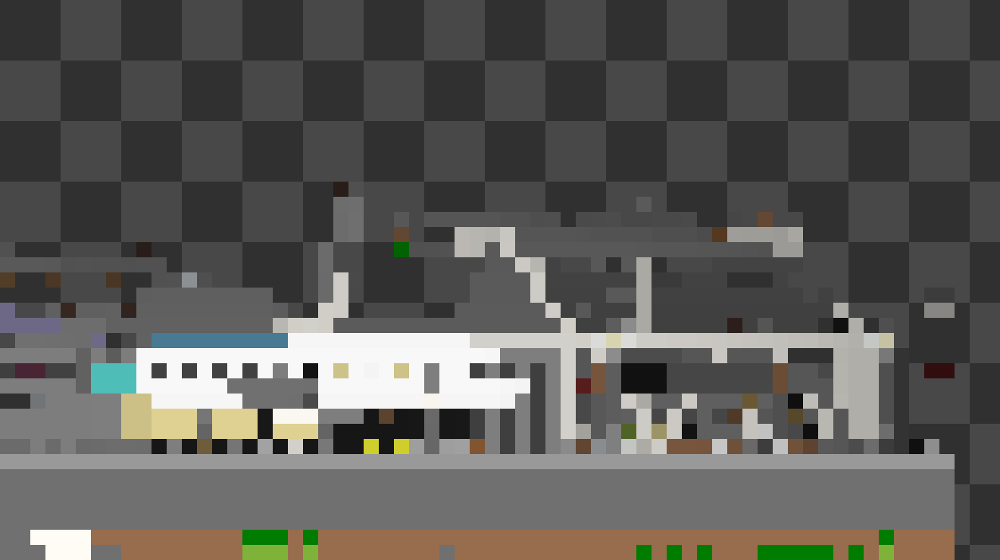

<p align="center"></p>

<h1 align="center">Almighty</h1>

<p align="center"><b>Всемогущий ИИ для твоего сервера Minecraft.</b><br>
Подключите Claude Code, Codex (он есть и в приложении ChatGPT для компьютера), Cursor, VS Code или локальную модель,
и агент станет ведущим на вашем сервере NeoForge: он видит мир, говорит с игроками, строит с откатом, проводит
события и управляет своими ботами-игроками.</p>

<p align="center">
Minecraft 1.21.1 · NeoForge 21.1.264+ · только на сервере, игрокам ничего ставить не нужно · GPL-3.0
</p>

<div align="center">

[English](README.md) · Русский

</div>

<p align="center">



</p>

## Быстрый старт

1. Положите `almighty-<версия>.jar` из [выпусков](https://github.com/zentixua/almighty/releases) в папку `mods/`
   сервера и запустите его. В консоли появится строка: `Almighty ready - tell your AI agent: "connect to my Minecraft
   server at http://127.0.0.1:25650/mcp"`.
2. Скажите агенту то же самое, можно и по-русски. Сервер он добавит сам.
3. Агент откроет страницу входа с четырёхзначным кодом. Наберите `/almighty approve <код>` в игре (как оператор) или
   в консоли. Готово: ни токенов, ни файлов настроек, ни лишних программ.

Подробнее: [Первые шаги](docs/guide/getting-started.ru.md) · [Подключение приложения](docs/guide/connect/README.ru.md) ·
[Режим ведущего](docs/guide/game-master.ru.md) · [Хостинг](docs/guide/hosting.ru.md) · [Руководство](docs/guide/README.ru.md)

> **Безопасность.** У подключённого агента права оператора, а со скриптами он ещё и выполняет код на машине сервера.
> По умолчанию мост слушает только `127.0.0.1`, каждое приложение входит по коду, который вы набираете на сервере, а
> известные команды, роняющие сервер, отклоняются для любого агента. Прочитайте [Безопасность](docs/guide/security.ru.md),
> прежде чем пускать на сервер незнакомых людей.

## Что умеет агент

- Видеть мир: карта сверху, как ванильная карта, вид на рамку с любой стороны, сверху или снизу и вид глазами игрока,
  бота, любой сущности или свободной камеры. Это картинки PNG с легендой; вид глазами ещё и перечисляет, что видно и
  что под прицелом. Блоки рамки можно прочитать и текстом.
- Читать сервер: темп тика, игроков (место, здоровье, инвентарь, эффекты), сущности в районе и корабли, если стоит
  Sable.
- Следить за игрой по ленте событий: чат, входы и выходы, смерти с причиной, достижения, смена измерения, команды
  игроков, личные сообщения ведущему и паузы сервера.
- Писать игрокам в чат, заголовком, подзаголовком или над хотбаром, всем или выбранным игрокам.
- Выполнять команды и функции с правами оператора (уровень 4), в том числе функции с макросами без файла датапака.
- Строить с откатом: fill, set и план слоями, частями между тиками. Откат возвращает блоки и содержимое
  блок-сущностей, например сундуков.
- Загружать чанки места, где никого нет, без тика, чтобы посмотреть на него или строить там.
- Выполнять скрипты Groovy в потоке сервера со сроком.
- Ставить правила: реакцию на любое событие NeoForge игры или любого мода. Правило выполняется на сервере в том же
  тике, может отменить событие и сохраняется с миром. Правило выключается само, если выходит за бюджет времени,
  падает 10 раз подряд или засыпает ленту записями.
- Заводить ботов. Бот — игрок сервера, который действует только пакетами, какие послал бы клиент: клавиши и мышь,
  хотбар, меню, чат и команды, таблички, возрождение. Боты ходят, копают, строят, берут из сундуков, ездят на
  лошадях, в лодках, на свиньях, страйдерах и верблюдах и летают на самолётах Immersive Aircraft. В табе и в чате у
  них пометка `[bot]`.

## Как это устроено

- На выделенном сервере мод запускает HTTP-мост, по умолчанию на `127.0.0.1:25650`. В одиночной игре мост не
  запускается. Мост принимает `POST /rpc` с `{"method": ..., "params": {...}}` и заголовком
  `Authorization: Bearer <токен>`.
- При первом запуске мод пишет случайный токен в `config/almighty/token` (32 байта в hex; в Linux и macOS файл читает
  только его владелец). В лог токен не пишется. Это токен агента `gm`; каждому следующему агенту свой токен даёт
  `/almighty agent add <имя>` (в `config/almighty/agents/<имя>.token`), а `/almighty agents` показывает, кто и откуда
  обращался последним.
- Запросы из браузера (с заголовком `Origin`) отклоняются, если этого источника нет в `bridge.allowed_origins`. Пять
  неверных токенов за минуту на время закрывают доступ с этого адреса.
- Мир читается и меняется только в потоке сервера: между тиками или работами, у которых своё время на тик
  (`work.ms_per_tick`, по умолчанию 3 мс). Большие постройки и картинки сервер не останавливают.
- Тот же порт отдаёт MCP по адресу `/mcp` (Streamable HTTP, нынешняя и прежняя версии протокола), поэтому любое
  MCP-приложение подключается просто по адресу, без адаптера. Приложения входят обычным входом MCP: сервер показывает
  на своей странице входа четырёхзначный код, а владелец набирает `/almighty approve <код>`. У агента 14 инструментов:
  `status`, `entities`, `command`, `say`, `script`, `rule`, `events`, `view`, `build`, `area`, `job`, `bot`, `notes`
  и `call` — любой метод моста по имени ([Инструменты](docs/guide/tools.md), на английском). Методы моста перечислены
  в [AGENTS.md](AGENTS.md) (на английском).
- Любой игрок может написать ведущему лично командой `/gm <текст>`. Другие игроки и операторы сообщения не видят,
  а агент может ответить только этому игроку.
  Если ведущий недоступен, ответ следует языку игрока: русский для `ru_ru`, иначе английский. Мод на клиенте не нужен.
  Сервер сам решает, какие строки чата адресованы ведущему (его имя, начатый разговор или игрок один на сервере),
  ограничивает каждого игрока 20 такими сообщениями в час и сообщает игроку, если ведущего нет. Если агентов
  несколько, `/gm @<агент> <текст>` выбирает одного.
- [Плагин Almighty](plugin/almighty/README.md) (по желанию, для Claude Code, Codex, Cursor и VS Code) добавляет навыки
  ведущего и запись сервера. [`mcp/gm/`](mcp/gm/README.md) добавляет, только для Claude Code, канал чата, который
  будит сессию, как только игрок пишет. Хук защиты от падений и запуск рецептов оттуда больше не нужны: сервер сам
  отклоняет опасные вызовы для любого приложения.

## Памятки для других модов

Агент узнаёт любую сборку от работающего сервера: `notes {query: "<id мода>"}` отдаёт блоки мода с состояниями,
предметы, рецепты, команды, события и значения настроек. Мод или датапак может ещё и оставить агенту памятку, как
работать с его механиками: файл Markdown `data/<namespace>/almighty/notes/<имя>.md`, по желанию с шапкой в формате
Agent Skills (`name`, `description`). Агент видит оглавление и читает памятку, когда она нужна; датапак перекрывает
памятку мода тем же путём, пустой файл её убирает. Без Almighty файл не читается. Подробнее:
[Для авторов модов и датапаков](docs/guide/for-mod-authors.ru.md).

## Установка

1. Сервер Minecraft 1.21.1 на NeoForge 21.1.264 или новее. Положите `almighty-<версия>.jar` из
   [выпусков](https://github.com/zentixua/almighty/releases) в папку `mods/` сервера и запустите его.
2. Скажите приложению агента: `connect to my Minecraft server at http://127.0.0.1:25650/mcp` (можно своими словами и
   по-русски) или добавьте сервер сами, как написано на странице приложения
   ([Подключение агента](docs/guide/connect/README.ru.md)).
3. Подтвердите вход кодом со страницы: `/almighty approve <код>`.

Для скриптов и CI без браузера дайте агенту токен (`/almighty agent add <имя>`) и передайте его через переменную
среды ([без браузера](docs/guide/connect/headless.ru.md)). Командная строка [`mcp/almighty.py`](mcp/almighty.py)
(`call`, `follow` и посредник stdio для приложений без HTTP) не обязательна, ей нужен [uv](https://docs.astral.sh/uv/):

```sh
uv run mcp/almighty.py call status                                      # один вызов, ответ — JSON
uv run mcp/almighty.py call map '{"center": [0, 0], "size": 256}' --png map.png
uv run mcp/almighty.py follow                                           # лента событий, строка JSON на событие
```

## Настройки

`config/almighty-common.toml`:

| Ключ | По умолчанию | Что это |
|---|---|---|
| `bridge.enabled` | `true` | Запускать HTTP-мост на выделенном сервере. |
| `bridge.host` | `"127.0.0.1"` | Адрес, который слушает мост. |
| `bridge.port` | `25650` | Порт моста. |
| `bridge.public_url` | `""` | Публичный адрес HTTPS, когда обратный прокси или туннель выводит мост в интернет (облачные приложения). |
| `bridge.allowed_origins` | `[]` | Адреса веб-страниц, которым можно обращаться к мосту; запросы других страниц отклоняются. |
| `bridge.tls_cert`, `bridge.tls_key` | `""` | Ваш сертификат (цепочка PEM) и ключ (PKCS#8 PEM): тогда мост говорит только по HTTPS. |
| `bridge.integrated` | `false` | Запускать мост и в одиночной игре и в мирах LAN (только на петле). |
| `work.ms_per_tick` | `3.0` | Время на тик сервера для построек, откатов и картинок, мс (от 0,5 до 20). |
| `work.build_max_blocks` | `2000000` | Наибольшее число мест в одной постройке. |
| `work.max_chunks` | `1500` | Сколько чанков агент держит загруженными сразу: постройки и подготовленные районы вместе с кольцом соседей. |
| `feed.lag_ms` | `1000` | Событие `lag`, когда между двумя тиками прошло больше стольких мс. |
| `scripts.enabled` | `true` | Метод `script` и правила со скриптом. |
| `bots.max` | `8` | Сколько ботов может быть на сервере сразу. Бот держит чанки, как игрок. |
| `bots.marker` | `"[bot]"` | Пометка перед именем бота в табе и в чате. Пустая — без пометки. |
| `bots.allow_disguise` | `false` | Разрешить бота без пометки или с именем или скином игрока, которого сервер знает. UUID у бота всегда свой, и имя он уступает, когда этот игрок заходит. |
| `name` | `"Claude"` | Имя, под которым ведущий пишет в чат и выполняет команды. |

Правила с `persist` хранятся в `<мир>/almighty/rules.json`.

## Безопасность

Мост даёт агенту права оператора. Со скриптами (они включены по умолчанию) он ещё и выполняет любой код в JVM
сервера с правами пользователя ОС, от которого запущен сервер: файлы, процессы, сеть. Доступ к мосту — то же, что
доступ к оболочке машины сервера.

- `bridge.host` — только петля (`127.0.0.1`, по умолчанию) или сеть, куда есть доступ лишь у владельца сервера,
  например адрес контейнера Docker, чей порт не опубликован. Мост говорит по обычному HTTP; его порт в интернет не
  открывать.
- Токены никому не передавать: у кого токен есть, тот управляет сервером. Сменить токен — `/almighty revoke <агент>`
  в консоли: старый сразу перестаёт работать, новый лежит в том же файле.
- Некоторые команды и вызовы отклоняются для любого агента, потому что роняют, вешают или останавливают сервер:
  `stop`, `reload`, `save-off`, `save-all flush`, `forceload add`, `tick rate` выше 100, `/almighty` (агенты и токены —
  дело владельца), а также стройка, загрузка и телепорт на координаты участков кораблей Sable. Отклоняются и скрипты,
  которые берут тикеты чанков, синхронно грузят чанки, запускают потоки, вешают слушателей, спят, завершают JVM или
  запускают процессы. Владелец по-прежнему может выполнить такие команды в консоли.
- Работа ведущего делит фиксированное время на тик (`work.ms_per_tick`). Когда сервер лагает (средний тик дольше
  50 мс 10 секунд подряд при 20 тиках в секунду), работа ведущего получает четверть своего времени, пока сервер
  не оправится.
- Выключить скрипты — `scripts.enabled = false`. Тогда метод `script` и правила со скриптом отклоняются, а
  сохранённые правила со скриптом не встают. Команды и правила без скрипта работают.
- Выключить мост — `bridge.enabled = false`.

## Другие моды

Almighty не зависит ни от одного мода. Поддержка этих модов включается, только когда они стоят:

- [Immersive Aircraft](https://modrinth.com/mod/immersive-aircraft): боты летают на его самолётах теми же рулями,
  что игрок. Проверено на версиях 1.5.2, 1.6.0 и 1.7.0 для Minecraft 1.21.1.
- Sable — физика кораблей Create Aeronautics: метод `ships` и `gm.ship(имя)` в скриптах отдают место корабля,
  поворот, скорость и рамки. Постройка и подготовка района на участке корабля отклоняются: этими чанками управляет
  Sable.

## Сборка

Java 21: `./gradlew build` — сборка и юнит-тесты, `./gradlew runGameTestServer` — GameTest на сервере без окна, с
Immersive Aircraft и Sable. Набор `mcp/gm` проверяют `python3 -m unittest discover -s mcp/gm/tests` и `node --test` в
`mcp/gm/almighty-chat`. Устройство мода, все методы моста и подводные камни — [AGENTS.md](AGENTS.md), на английском.

## Лицензия

Автор Almighty — ZentixUA. Лицензия — GNU General Public License версии 3, только эта версия
([LICENSE](LICENSE)). В jar вшит Groovy 4 под лицензией Apache 2.0.
