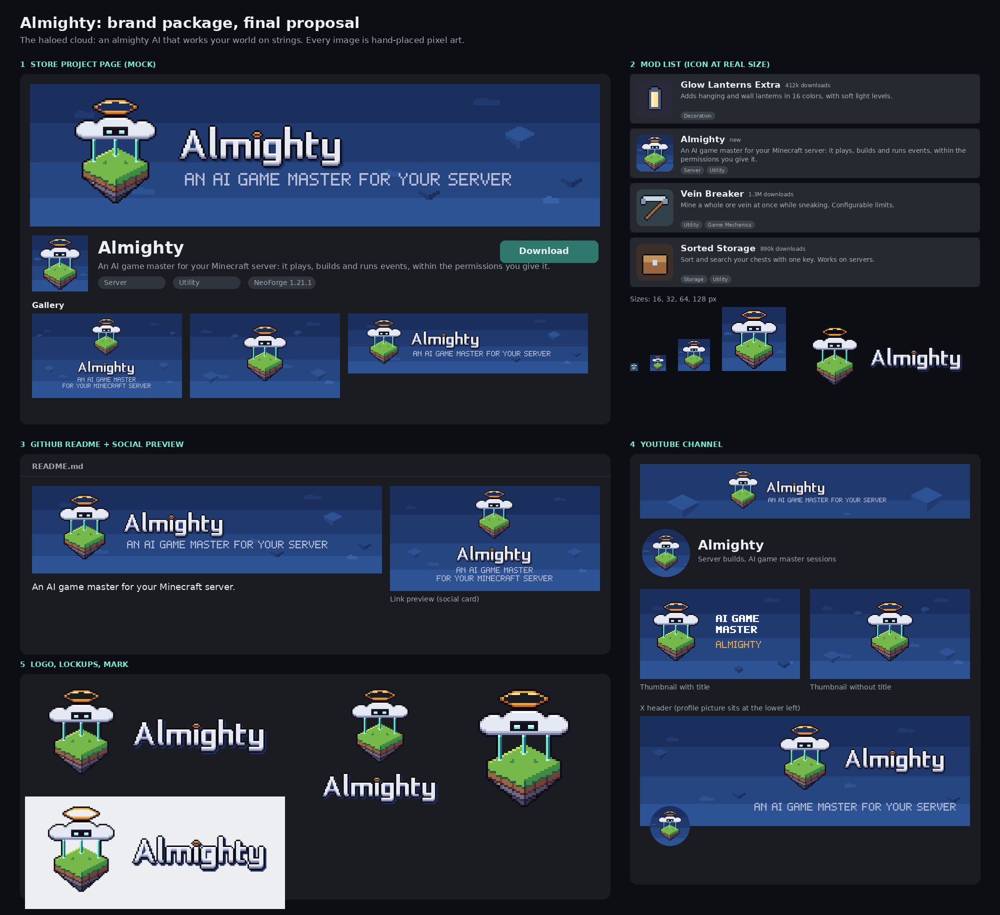

# Almighty brand

The final mark is a **haloed cloud**. It wears the agent's small visor and works a floating island on strings. Read
together with the name: an almighty AI (halo + visor) that works your Minecraft world (island on strings), held on
strings, not loose.

All artwork is hand-made pixel art on a grid (the presentation sheet's page chrome and captions are a plain system-font mock). The images are drawn in code (`scripts/brand/`: Python + Pillow,
rectangles, lines and pixel lists) and enlarged only by whole nearest-neighbour factors, with no image generation,
filters or blur. Rebuild the package with `python3 scripts/brand/final_kit.py`, then `python3 scripts/brand/final_sheet.py`.
How the mark was chosen (nine rounds of blind tests) is in [`exploration/`](exploration/).

## Files and where they go

| File | Size (native grid x factor) | Use |
|---|---|---|
| `icon/icon-64.png` | 64x64 (x1) | Pixel source of the square icon |
| `icon/icon-128.png` | 128x128 (x2) | Small store icon |
| `icon/icon-512.png` | 512x512 (x8) | Modrinth and CurseForge project icon |
| `icon/mark-transparent-512.png` | 512x512 (x8) | The mark without background, for overlays and video |
| `logo/logo-horizontal.png`, `-native.png` | 4x / 1x | Logo: mark + wordmark, transparent. README top, docs, store description |
| `logo/logo-stacked.png` | 4x | Logo, stacked, for square or tall spaces |
| `logo/wordmark.png` | 4x | Wordmark alone |
| `logo/modlist-logo.png` | 2x | The mod's in-game logo: copied to `src/main/resources/almighty.png` (`logoFile`, shown with `logoBlur = false`) |
| `banner/readme-banner-1280x320.png` | 320x80 (x4) | README and pack-list header |
| `store/modrinth-banner-1920x480.png` | 320x80 (x6) | Modrinth description header |
| `store/modrinth-cover-1920x1080.png` | 240x135 (x8) | Modrinth gallery, featured image |
| `store/curseforge-header-1600x400.png` | 320x80 (x5) | CurseForge description header |
| `social/github-social-1280x640.png` | 256x128 (x5) | GitHub repository social preview |
| `social/avatar-400.png` | 80x80 (x5) | Profile picture (X, YouTube, Discord); safe for a circular crop |
| `social/x-header-1500x500.png` | 300x100 (x5) | X header; the lockup sits high and right, clear of the profile picture |
| `social/youtube-2560x1440.png` | 512x288 (x5) | YouTube channel art; the lockup sits inside the 1546x423 safe area |
| `video/thumbnail-title-1280x720.png` | 160x90 (x8) | Video thumbnail with a short title (the title is a placeholder) |
| `video/thumbnail-plain-1280x720.png` | 160x90 (x8) | Video thumbnail without text |
| `final.png` | 2000x1830 | Presentation: store page, mod list, GitHub, YouTube, logos |

Applied in the repository: the mod's logo (`src/main/resources/almighty.png`) and the banner at the top of
`README.md` and `README.ru.md`. Not applied yet, because they change public pages: the store icons
(`docs/media/icon.png`, `icon-400.png`) and the store, social and video images. Those go live with a store update
or upload.

## Palette

Ramps run dark to light. Their darks lean violet and their lights lean warm or cyan, so shading shifts hue as
well as value. Use these colours only; mix nothing in between.

| Ramp | Colours | Where |
|---|---|---|
| Sky | `#1A2F5E` `#203A70` `#264682` `#2E5394` `#3A62A6` | Backgrounds: flat bands, darkest at the top |
| Cloud | `#4B4E7A` `#7B80A8` `#B6BCD6` `#E4E9F4` `#FFFFFF` | The cloud and the wordmark letters (lit top, violet-grey underside) |
| Gold | `#4A1E2C` `#8C3B2E` `#C9692C` `#EDA640` `#FFE69C` | The halo; the i's halo; accents |
| Agent cyan | `#123349` `#1C6676` `#2FB0A6` `#7BEBCF` `#E2FFF3` | Eyes, strings, string anchors |
| Visor | `#120F1F` `#1F1A33` | The visor |
| Turf | `#163238` `#235A45` `#3F8A45` `#76B84A` `#C6E46E` | Island top and turf lip |
| Soil | `#2A1828` `#4A2A33` `#704338` `#9A6640` `#C3925C` | Island soil band |
| Stone | `#1E1B2D` `#343049` `#4F4A65` `#736C86` `#A39BAF` | Island rock and keel |
| Ink | `#0E0B16` | One-pixel outline on the outer silhouette only |

## Typography

- **Wordmark:** "Almighty", drawn for the mark (`scripts/brand/final_type.py`). The stems are 3 px. The A is a true capital with a peaked apex. The l is taller than the A and ends in a foot, so "Al" never reads as "AI". The dot of the i is a small gold halo. The letters are shaded like the cloud.
- **Tagline and titles:** the 5x7 pixel capitals in `scripts/brand/fonts.py`, in cloud grey `#B6BCD6`. The tagline is plain: "An AI game master for your server" ("... Minecraft server" where there is room). No slogans.

## Clear space and minimum sizes

- **Clear space:** keep a free margin around the mark and the lockups equal to the halo's height (8 px at the 64 px native size, 1/8 of the mark's height). Nothing else may come inside it.
- **Icon:** minimum 32 px. At 16 px the mark is only a hint of cloud and island; for favicons, use it only next to the name.
- **Horizontal lockup:** minimum 160 px wide (the native size), so the wordmark keeps 3 px stems. Below that, use the icon alone.
- **Scaling:** whole factors only (x2, x3, x4 ...), nearest-neighbour. Never smooth-scale the art up; downscaling is acceptable only for previews.

## Do

- Use the icon on the sky tile; use the transparent mark or logo on dark or light grounds. Both carry their own ink outline.
- Keep the halo, the visor, the strings and the island together. They are one mark.
- Put plain words beside it: the name, and the plain tagline when there is room.

## Don't

- Don't redraw, recolour, rotate or skew the mark, and don't add glow, gradients, drop shadows or a 3D bevel.
- Don't remove the halo (it is the "almighty") or the visor (it is the "AI"). Don't enlarge the face: a big face reads as a TV.
- Don't put the mark on busy screenshots without the sky tile or a dark panel behind it.
- Don't stretch the wordmark, typeset "Almighty" in another font next to the mark, or use "AI" letters as a badge.
- Don't use a slogan as the tagline.

## Quality checks

The final mark was checked by fresh, independent judges (each an empty `claude -p` session that saw only the image):

- **Against popular mod icons** at 64 px (Create, Sodium, JEI, Xaero's Minimap, in random order): rated professional in 3 of 8 reads and "decent, leaning professional" in 2. In every read it was at or above Sodium, JEI and Xaero's Minimap, and Create was the only icon rated above it.
- **Alone, harsh look check:** "decent" in all 7 reads: clean, readable and not AI-made. The repeated critique is that the concept (a cloud over a floating island) feels generic.
- **Meaning:** in blind scoring with only the icon and the name, judges read it as "a god-like / divine AI that controls a floating island … world control" ([`exploration/scores3.md`](exploration/scores3.md)).
