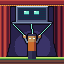
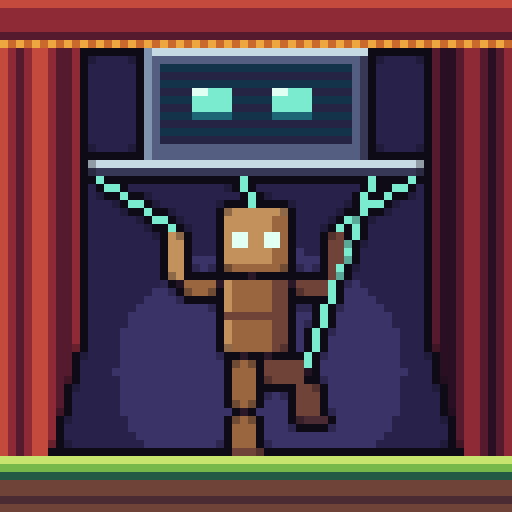
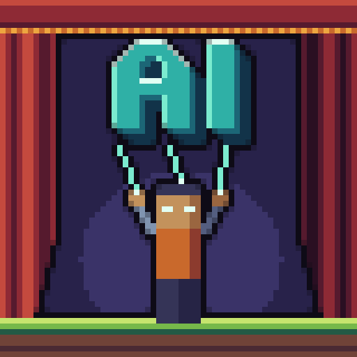

# Mark finalists (round four)

Sheet: each finalist as a store list card with its chosen summary, beside the large icon: [`finalists.png`](finalists.png).

Three finalists from a self-run iteration. 21 candidates were drawn: Puppeteer refinements (#4, #5) and fresh concepts. They were judged blind, and failing ideas were dropped. Sheet: [`finalists.png`](finalists.png). Single icons: `finalists/NN-name-64.png`, `-512.png`, `-32.png`. Source: `scripts/brand/cand.py`, sheet `scripts/brand/finalists.py`.

## How they were judged

Each judge was a fresh `claude -p` session in an empty directory that saw only one icon, at 32 px and 64 px. Prompt: *"You are an ordinary Minecraft player scrolling a feed of mods (Modrinth list, Reddit, YouTube). You glance at one mod's icon for about two seconds … what do you think this mod does, and would you click it?"* A separate fresh session gave the look check on the 512 px icon: *"Does this look AI-generated or amateur? Be harsh … verdict: professional, decent, or amateur."*

## Honest bottom line

None of the 21 candidates gets the full meaning ("an AI controls the world and its players, with the owner in charge") from a two-second glance. What the judges did pick up:

- **Puppet stage + screen with eyes + figure on strings** gives the closest meaning without letters: *"a puppet or marionette show: a small figure on strings under a robot-like face … a character-control gimmick"*. The curtains also make it stand out in a feed ("stands out from the usual sword and pickaxe icons").
- **Big "AI" letters** are the only cue that reliably reads as AI, but every judge read them as an "AI companion / NPC / chatbot", and most added that "AI" mods feel gimmicky. Treat that as a real market signal.
- **Look:** all three finalists got "decent" (clean, consistent pixel grid, not AI-made). None got "professional". The repeated critiques are stiff figures and a flat background.

## Card test (the deciding test)

Artem's clarification: a real user sees the mod's name, icon and one-line summary together, as a store list card. Each judge was a fresh `claude -p` session in an empty directory that saw only a screenshot of a mock list. The list had four cards: Almighty (icon at 80 px, the name, a summary, tags) among three ordinary invented mods, with Almighty's position varied. Prompt: *"You are an ordinary Minecraft player scrolling a list of mods on a mod site … quick glance … what does the mod called Almighty do, would you click it, and why?"* The card frame and text use a plain system font, as a store would; only the icon is ours. Renderer: `scripts/brand/cards.py`.

Summaries tested (plain words, no slogan):

- **A:** "An AI agent runs your Minecraft server as a game master, within the permissions you give it."
- **B:** "Give an AI a real player body and admin power on your server. You decide what it may do."
- **C:** "Server-side bridge for AI agents: they see the world, play as bots, build and run events under your rules."

Result: with a summary next to it, every one of the 12 card judges understood the mod and said they would probably click. Several said Almighty was the only card on the list that sounds new. The icon's job is to stop the scroll, and judges named it ("puppet-master icon", "puppet on a stage stands out"). The summary carries the meaning. A carries "the owner is in charge" best. B is the most intriguing ("I'm curious what an AI player would get up to") but draws "admin power sounds risky". C was called "vague" and lost to the utility mods, so it is dropped.

Chosen pairs: **1 + A**, **2 + B**, **3 + A** (cards in `finalists/NN-name-card.png`).

### All nine icon × summary reads (verbatim)

**Icon 1 + summary A**

> Almighty is a server mod where an AI agent acts as a game master for your Minecraft server, working within whatever permissions you give it. I'd probably click it out of curiosity, since the idea is unusual and the art catches the eye. It's brand new, though, with no download count yet, so I'd check the page for how it works and whether it's safe before installing it on a server I care about.

**Icon 1 + summary B**

> Almighty gives an AI a real player body on your server, plus admin powers, and you decide what it's allowed to do. I'd probably click it. The icon of a puppeteer-style robot on a stage stands out, and the idea is new and odd enough that I'd want to see what it can do. I'd also be a bit wary of handing admin power to an AI, and it has no download count yet, so I'd read the description page before installing it.

**Icon 1 + summary C**

> Almighty is a new server-side mod that lets AI agents see the world, play as bots, and build or run events under the server owner's rules. I'd probably click it out of curiosity, since AI bots playing on a server is an unusual idea and the icon looks fun. I'd only stay if I run a server, though, because it's brand new with no download count yet and the others look more immediately useful to me.

**Icon 2 + summary A**

> Almighty is a new mod that puts an AI agent in charge of your Minecraft server as a game master, working within whatever permissions you give it. I'd probably click it, because the icon, a puppet on a stage, is eye-catching and the idea is unusual. I'd read the page before installing, though. It has no download count yet, and I'd want to know how much control I'm handing over.

**Icon 2 + summary B**

> Almighty is a new server mod that gives an AI a real player body plus admin powers on your server, and you set what it's allowed to do. I'd probably click it. It's the only one on the list that's different from the usual utility mods, and I'm curious what an AI player would actually get up to. I'd read the page carefully before installing it, though, because admin power sounds risky.

**Icon 2 + summary C**

> Almighty is a new server-side mod that lets AI agents connect to your world, see it, play as bot players, and build or run events under rules you set. I'd probably give it a quick click out of curiosity, since the puppet-on-a-stage icon and the AI-bots idea are unusual. But I'd only stay if I run a server. It's brand new with no download count yet, so I'd want to see reviews first, and the other mods on the list look more immediately useful.

**Icon 3 + summary A**

> Almighty puts an AI agent in charge of your Minecraft server as a game master, and it only does what the permissions you give it allow. I'd probably click it out of curiosity, since it's new and the puppet-master icon looks fun. I'd want to read more before installing it, though, because it has no download count yet and I'd be wary of handing an AI control of my server.

**Icon 3 + summary B**

> Almighty gives an AI a real player body and admin powers on your server, and you set what it's allowed to do. I'd probably click it out of curiosity, since it's a novel idea and the puppet-on-strings icon is eye-catching. I'd be wary, though: it's brand new with no download count yet, and handing admin power to an AI is risky.

**Icon 3 + summary C**

> Almighty is a server-side mod that lets AI agents see the world, play as bot players, and build and run events under rules you set. It's new, so it has no download count yet.
> >
> > I'd probably click it, since "AI bots that play and build on my server" is an unusual idea and I'm curious. I'd still hesitate a bit, because it's brand new and the description is vague. Vein Breaker or Sorted Storage, with their big download numbers, are the safer picks if I just want something useful.

### Second read of the chosen pairs (different list position)

**Icon 1 + summary A**

> Almighty puts an AI agent in charge of your Minecraft server as a game master. It can only act within the permissions you give it. I'd probably click it, since it's the only one on the list that sounds new and different, and I'm curious what an AI game master would actually do. I'd still check the details first, because it's brand new with no download count yet, and I'd want to know how much control it really gets.

**Icon 2 + summary B**

> Almighty gives an AI a real player body and admin powers on your server, and you set what it's allowed to do. I'd probably click it out of curiosity. The puppet-on-strings icon is eye-catching, and an AI player is a novel idea. I'd be wary, though: it's brand new with no download count yet, and "admin power" sounds risky, so I'd read the details before installing it.

**Icon 3 + summary A**

> Almighty is a new server mod where an AI agent acts as a game master and runs your Minecraft server, within whatever permissions you give it. I'd probably click it out of curiosity, since it's the only one on the list that sounds new and different, and the AI-icon art stands out. I wouldn't install it blind, though. It has no download count yet, and I'd want to read what permissions it asks for before trusting an AI with my server.

## Finalists (icon-only glance test)

### 1. Stage, screen puppeteer

  

Stage, screen puppeteer: on a puppet stage, a screen with the agent's eyes works a player on strings; the player's eyes carry its light.

Feed-scroller reads (verbatim):

> Looks like a little character or robot standing on a stage between red curtains, so I'd guess it's a theater, puppet or cutscene mod, or maybe a NPC/animation tool. It's a bit murky at 32px, so I'd only click if the title made the purpose clear.

> I can't really tell what it does. It looks like a figure or robot standing on a stage between red curtains, so my guess is a mod about theaters, puppets or some kind of NPC or animatronic. The icon is cute and distinctive, so I might click it out of curiosity, but I wouldn't know what I was getting.

> Looks like a puppet or marionette show: a small figure on strings under a robot-like face, with red stage curtains around it. I'd guess it adds puppets, a theater or stage, or maybe a character-control gimmick. The curtains make it stand out from the usual sword and pickaxe icons, so I'd probably click out of curiosity, though I can't tell what it actually does.

Look check (verbatim):

> This doesn't look AI-generated: the pixels are clean and consistent, with no mushy anti-aliasing or garbled details. The concept is clear, a robot monitor puppeteering a Steve-like figure on a curtained stage, and the limited palette and spotlight glow are handled well. The weak spots are the flat, blocky figure with a barely readable face, the stiff string lines, and the muddy dark-purple background that lacks dithering or texture. It's competent and readable at small sizes but not polished. Verdict: decent

### 2. Stage, marionette

  

Stage, marionette: the same screen puppeteer works a wooden block-built marionette with lit eyes, one knee lifted by its string.

Feed-scroller reads (verbatim):

> Looks like a little robot or puppet on a stage with red curtains, so maybe a mod about robots, automation or a puppet-show or theater theme. The art is cute and eye-catching enough that I'd probably click to find out, though I can't tell what it actually does from the icon.

> Looks like a robot or villager-ish character standing on a stage with red curtains, so I'd guess a mod about NPCs, puppets or performances, or maybe a robot companion. It looks fun and quirky, so I'd probably click it out of curiosity, but I'm not sure what it actually does from the icon.

> Looks like a mod that adds a robot or puppet character, maybe a puppeteer or a theater or stage mod, since there are red curtains and a little marionette-like figure. It's cute and stands out a bit, so I'd probably click to see what it does, though I can't tell from the icon alone.

Look check (verbatim):

> This is not obviously AI-generated, because the pixel grid is consistent and the outlines are clean, with no mixed resolutions or mushy anti-aliasing. The concept reads clearly: a puppet robot on strings under a monitor, on a stage with curtains. The weak spots are the flat, low-contrast spotlight circle and the stage floor, which is a thin, muddy strip. The puppet's limbs are stiff and its strings tangle awkwardly on the right side, so the piece is competent but a little generic. Verdict: decent

### 3. Stage, AI bar

  

Stage, AI bar: big extruded AI letters are the control bar; their strings work a player whose eyes carry the light.

Feed-scroller reads (verbatim):

> It looks like an "AI" mod: a little pixel character with its arms up, standing under a big "AI" sign between red stage curtains. My guess is it adds AI companions or NPCs, or something like a chatbot, and the stage setting might mean a performance or show. I'd probably skip it, since "AI" mods tend to feel gimmicky, but the curtains make me curious enough that I might glance at the description.

> It looks like an AI-themed mod: a little character standing on a stage in front of red curtains, with a big "AI" sign above. My guess is it adds AI-controlled NPCs or companions, or lets you chat with an AI. I might click it out of curiosity, but "AI" mods often feel gimmicky, so I'd only click if the title promised something concrete.

> Looks like an AI mod: a puppet or character hanging on strings under an "AI" sign, with stage curtains around it. I guess it adds AI-controlled or puppet-style NPCs or companions. I'd probably click it out of curiosity, but I'd worry it's a chatbot gimmick.

Look check (verbatim):

> This isn't obviously AI-generated, because the pixel grid is clean and the shading is consistent. It is still a generic concept: a Steve-like puppeteer holding a big "AI" sign on strings in front of red curtains. The composition is stiff and symmetrical, the figure has a blank, flat face and awkward arm and hand anatomy, and the lettering has no real style. The colors and outlines are tidy and readable, but nothing in it is distinctive. Verdict: decent

## Dropped along the way (one-line gist of the reads)

| Candidate | What the glance judges saw |
|---|---|
| #5 screen hand → island / block / network (A, C, F) | "ghostly jellyfish", "drone scanning land", "tech panel teleporting blocks" |
| #5 screen hand → player on a block (B) | "remote control, puppets" once, then "robot head, automation" twice; look: amateur |
| Screen hand gripping a marionette bar (G) | "grappling hook / zipline" |
| Monitor puppeteer, no stage (H, P) | "robot / golem / automation machine" |
| Hologram hand + bar (I), robot hand + bar (Q) | "parachute / air drop", "house hanging from a crane" |
| Cursor + bar + player (E, R) | "UI cursor tweak", "crossbow / ranged weapon" |
| Screen-headed player (J) | "robot or helper mob" |
| Possessed puppet, strings off-frame (K) | "grappling hooks or ropes" |
| RTS selection box + cursor (O) | "select / move entities, editor tool" |
| AI sparkle over island / cube / puppet (S1, S3, S6, S7) | "skyblock / star / space"; looks "clean, readable" but no AI |
| Big AI over island / player, no stage (L1, L3, T3) | "AI companion / NPC / chatbot, gimmicky" |
| Wooden marionette under a screen hand, no stage (F3) | "jellyfish / UFO over a figure" |
| Stage + big AI + wooden marionette (F2) | "AI companion / chatbot"; 32 px reads as a teal blob |
