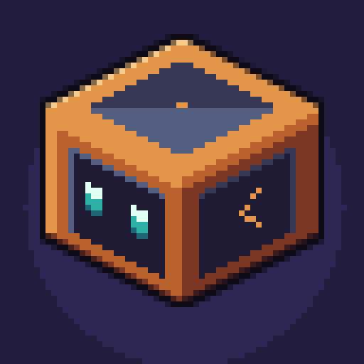
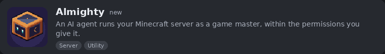
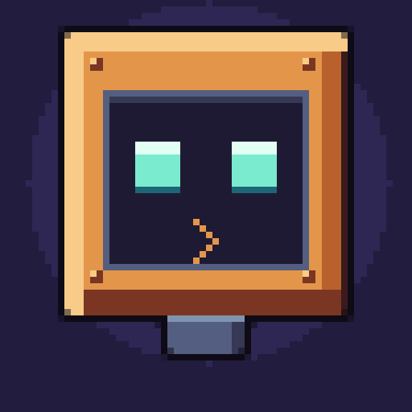
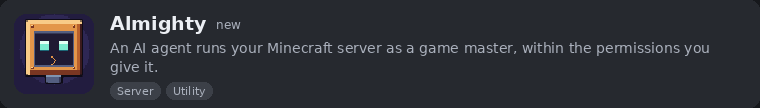
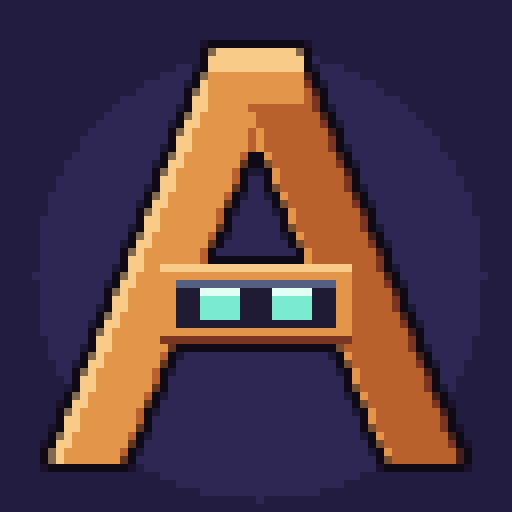
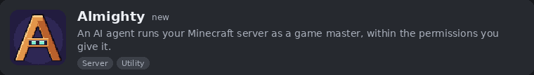
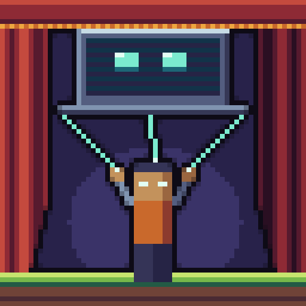
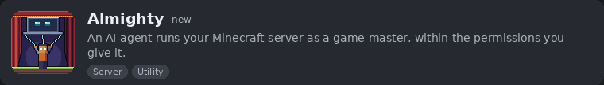

# Mark finalists, round five

Sheet: [`finalists2.png`](finalists2.png). Each finalist is shown with the icon large, as a store list card at real size, and at 64 and 32 px. Single files: `finalists2/NN-name-{64,512,32,card}.png`. All 28 concepts: [`concepts32.png`](concepts32.png). Source: `scripts/brand/concepts32.py`, `round5.py`, `finalists2.py`, `cards.py`.

## 1. The message

What the mark must say in two seconds: **an AI that can do anything in your Minecraft world, on your leash.**

The card's one-line summary says it in plain words: *"An AI agent runs your Minecraft server as a game master, within the permissions you give it."* Summary A was kept from round four, where it carried "the owner is in charge" best.

## 2. Process

1. **Diverge:** 28 concepts drawn natively at 32 px, from Minecraft-native symbols and abstract marks: the command block (alive, on a lead, crowned, caged, with an ender eye), player heads (glowing eyes, command-block face, on a lead, crowned, possessed), the lead, the ender eye, a hand placing a block, a totem, and monograms. The command block is our own drawing in the vanilla manner: framed faces, dark insets and an arrow mark.
2. **Cut:** an icon-only glance judge read all 28, one fresh session each, seeing only that icon at 32 and 64 px. Reads below. Six went on, one per concept family. I picked from the reads: whatever read as robot or agent, or was called eye-catching and clickable, from different families.
3. **Refine:** the six were redrawn at 64 px with hue-shifted ramps, an outline only on the outer silhouette, softened stair-steps and a two-tone tile in place of a flat filler.
4. **Retest:** each of the six got two glance reads, two list-card reads and one harsh look check. The card judge sees a screenshot of a store list in which Almighty sits among three ordinary invented mods, with its slot varied.
5. **Benchmark:** two art-director reads of a sheet with our icons and four popular mod icons (Create, Sodium, JEI, Xaero's Minimap) at 64 px, shuffled and numbered. The popular icons were used for this comparison only and are not in the repository.
6. **Refinement pass** on three of them, then a second benchmark.

Every judge was a fresh `claude -p` session (Sonnet) in an empty directory that saw only the images named. No session saw this repository or any other answer.

## 3. Bottom line

- **The list card works with every finalist.** All card judges understood the mod (an AI game master on your server, within the permissions you give it) and said they would probably click. Many added a fair worry: it is new, and giving an AI server control is a lot of trust.
- **The icon alone still does not say "AI controls your world" in two seconds.** Glance judges read the finalists as a living crate or robot cube, a robot or terminal block with a `>` prompt ("programmable robots, computers, or command blocks"), an A with a visor face ("helper/assistant"), and a puppet stage. The block head comes closest. The icon's real job, stopping the scroll and fitting the summary, is met.
- **The vanilla command block is not recognised at 32 px by an outsider.** In all 28 reads, nobody said "command block". Orange cubes read as chests, crates or mimics. Only the block head's `>` prompt drew "command blocks".
- **Look:** the living command block was rated **professional** by both art directors in the first benchmark, above all four popular icons. The other finalists rated decent. The benchmark is noisy, though: the same judges called Create's real icon "AI-generated" and Sodium's and JEI's "amateur". Use it as a level check, not a verdict.

## 4. Finalists

### 1. Living command block

 

The block every player knows as admin power, awake, with the agent's eyes in its panel. Family: vanilla power symbol.

Icon-only glance (verbatim):

> Looks like a mod about storage or crates: an orange and brown box with a little glowing face on a purple background. It could be a backpack, chest or container mod. It looks cute and polished, so I'd probably click it to find out.

> It looks like a storage mod. The icon is an orange and brown chest or crate with a glowing blue face, so I'd guess it adds fancy or tech-style containers, maybe with extra inventory features. I'd probably click it, since the icon is clean and distinctive, though it looks a lot like other storage mods, so I'd want the title or description to tell me what makes it different.

List card with the summary (verbatim):

> Almighty is a server mod where an AI agent acts as a game master for your Minecraft server, limited to the permissions you give it. I'd probably click it out of curiosity, since it's tagged "new" and an AI running events is an unusual idea. But I'd be cautious, because it has no download count or track record yet, and I'd want to see what permissions it asks for before putting it on a server with other people.

> Almighty puts an AI agent in charge of your Minecraft server as a game master, and it only does what the permissions you give it allow. I'd probably give it a click out of curiosity if I run a server, since it's the only one here that does something unusual. It's labeled "new" and has no download count yet, so I'd check the page for reviews before installing it. If I only play singleplayer, I'd skip it for Vein Breaker or Sorted Storage, which have far more downloads.

Harsh look check (verbatim):

> It's clean and readable. The isometric cube has a consistent outline, a coherent palette, and sensible light and shadow. It still looks generic and slightly AI-adjacent. The cyan "eyes" and the orange "<" glyph don't clearly say what the mod does, the top face is a flat unexplained trapezoid, and the pixel clusters are a bit inconsistent in size. It has no dithering, no texture and no Minecraft-style material detail, so it reads as a competent stock asset more than a crafted mod icon. **Verdict: decent**

### 2. Block head

 

A head built from a command block: its screen is the agent's face and its arrow is the mouth. Family: agent face.

Icon-only glance (verbatim):

> I think it adds a little robot or computer-terminal block with a glowing face and a ">" prompt. That suggests a programmable or command-block style mod, or maybe a companion bot. The orange frame and teal eyes look clean, but it's pretty generic. I'd probably click it out of mild curiosity, though I can't tell what it actually does from the icon.

> It looks like a little orange robot or computer-terminal block with glowing cyan eyes and a ">" prompt, so I'd guess it adds programmable robots, computers, or command blocks. I'd probably click it, since the icon is clean and distinct and the idea is intriguing. It's a bit generic, though, so I wouldn't be sure what it does until I read the title.

List card with the summary (verbatim):

> Almighty is a new server mod where an AI agent acts as a game master for your Minecraft server, working within the permissions you give it. I'd probably click it out of curiosity, since an AI game master is a novel idea and the "new" tag stands out. I'd still be wary, because it has no download count yet and an AI with server control sounds risky.

> Almighty is a new mod that puts an AI agent in charge of your Minecraft server as a game master, and it only acts within the permissions you give it. I'd probably click it out of curiosity, since it's the only one on the list that sounds different, and the "within the permissions you give it" line makes it feel safer to try. I'd still want to see reviews first, because it has no download count yet and I'd be wary of letting an AI loose on my world.

Harsh look check (verbatim):

> It's clean but generic: a boxy robot-monitor face with a flat palette, simple bevel shading, and a symmetrical layout that reads as a template. The ">" mouth is off-center and ambiguous, the eyes are plain blocks with no highlights or personality, and the stubby neck and vignette circle feel like filler. Nothing in it says what the mod does, and it has no Minecraft-style texture, dithering or detail, so it would be forgettable in a mod list. Verdict: amateur

### 3. Monogram A

 

An A in command-block orange, its crossbar the block's inset holding the agent's eyes. Family: abstract letter mark.

Icon-only glance (verbatim):

> It looks like an orange letter "A" with a little robot or visor face on a dark purple background, so I'd guess it's some kind of helper or automation mod, maybe an assistant or "A"-named utility. The "A" is clear and the icon looks clean, but I can't tell what it actually does, so I'd only click if the name sounded interesting.

> Looks like a big orange "A" with a little robot or visor face in the middle on a dark blue background. I'd guess it's some kind of A-named utility mod or a robot/helper companion. It's a clean icon but vague, so I'd only click if the title caught my interest.

List card with the summary (verbatim):

> Almighty is a server mod where an AI agent acts as a game master and runs your Minecraft server, limited to the permissions you give it. I'd probably click it out of curiosity, since it's new and the idea is unusual, and the cartoon "A" icon draws the eye. I'd read the page carefully before installing it, though, because it has no download count yet and an AI with server control is a lot of trust to give.

> Almighty is a server mod where an AI agent acts as a game master and runs your Minecraft server, within whatever permissions you give it. I'd probably click it out of curiosity, since it sounds novel and the "new" tag and Server tag catch the eye. I'd be cautious about installing it, though. It has no download count or track record yet, and the other mods listed have hundreds of thousands to millions of downloads.

Harsh look check (verbatim):

> It's clean and readable, with a consistent palette, a sensible light direction and a tidy dark outline. The concept is generic, though: a big letter "A" with a visor tacked on, and nothing says what the mod does. The shading is flat and slightly mushy, and the glow circle behind the letter is just a faint blob. It looks competent but a bit templated, with no Minecraft-style texture or detail, so I can't tell whether it's AI-assisted or just a simple hand-made icon. Verdict: decent.

### 4. Puppeteer

 

On a puppet stage, a screen with the agent's eyes works a player on strings. This is the #1 Artem chose from the Puppeteer round. Family: control metaphor.

Icon-only glance (verbatim):

> Looks like a mod about a theater, puppets, or stage performance. There's a figure hanging from strings under a robot-looking head, with red curtains on both sides. The icon is a bit muddy at 32px, but the curtains make it readable enough that I'd probably click out of curiosity.

> It looks like a little robot or character with glowing blue eyes standing on a stage between red curtains, so I'd guess a mod about puppets, mannequins, or theatrical or animated NPCs. The scene is cute and distinctive enough that I'd probably click to see what it does, though I'm not sure what it is from the icon alone.

List card with the summary (verbatim):

> Almighty is a server mod where an AI agent acts as a game master for your Minecraft server, working within the permissions you give it. I'd probably click it out of curiosity, since it's new and the idea is unusual. I'd also be wary: it has no download count yet, and I'd want to see what the agent can actually do before putting it on a server with friends.

> Almighty is an AI agent that runs your Minecraft server as a game master, within whatever permissions you give it. I'd probably click it out of curiosity if I run a server, since the icon is eye-catching and the idea is new. It's tagged "new" and has no download count yet, so I'd check the page and reviews before installing it. If I only play singleplayer, I'd scroll past it for something like Vein Breaker.

Harsh look check (verbatim):

> It's clean and readable, and the concept works: a Steve-like figure on a stage is puppeteered by a robot-monitor with glowing strings, which is a clever twist on "AI controls the player." But the composition is stiff and symmetrical, and the figure is crude, with a blank faceless head, stick arms and no shading on the body. The curtains and background are flat, with smooth gradients and a clean vignette glow that feel more like a generated or vector-derived look than hand-placed pixels. It's competent but generic, and it has no distinct Minecraft style or texture detail. Decent.

## 5. Benchmark (verbatim)

**First sheet.** Order: 1 Create, 2 living block, 3 Sodium, 4 monogram (first pass), 5 possessed head, 6 JEI, 7 block head (first pass), 8 puppeteer, 9 Xaero's Minimap, 10 leash.

> 1. Decent. Clean round badge, but the wrench is generic and a bit muddy at this size. 2. Professional. Strong isometric cube, clear silhouette, good value contrast. 3. Amateur. Flat white flame on a green square, no depth, stock-glyph look. 4. Decent. Bold "A" with a glowing visor reads well, but the shading is simplistic. 5. Decent. Readable Steve-like face, but the pixel detail is inconsistent and the glasses are awkward. 6. Amateur. Plain "J" in a box, with no craft or concept. 7. Decent. Friendly monitor-bot, tidy, but generic and low-contrast against the teal background. 8. Decent. Ambitious stage scene, but it's busy and the figure turns to mush at 64 px. 9. Amateur. It's a map or screenshot crop, not an icon. No composition and no focal point. 10. Decent. Same cube as 2 with a crane arm added. The arm is cluttered and the silhouette is weaker. AI-generated: none look clearly AI-generated. The pixel work is hand-built and consistent. 8 and 1 are the most suspect because of their painterly rendering, but I wouldn't call either one.

> 1. Decent. Clean circular badge with a readable wrench, but generic and a bit flat. 2. Professional. Strong isometric cube, consistent shading and a clear focal point. 3. Amateur. A flat white flame on a green square, with no depth or detail. It reads as a stock glyph. 4. Decent. A bold "A" with glowing eyes and a good silhouette, but the shading is muddy. 5. Amateur. The face is smooth and over-rendered with inconsistent pixel density. This one looks AI-generated. 6. Amateur. A plain "J" in a box that looks like a default font. It's not really an icon. 7. Decent. A cute robot-monitor with clear shapes, but a little generic. 8. Amateur. The scene is busy, with muddled detail and an unreadable focal point at 64 px. It looks AI-generated. 9. Decent. A map crop that reads fine, but it's a screenshot rather than a designed icon. 10. Decent. It has a nice concept and palette, but the contraption is cluttered and the detail turns to mush at this size. It may be AI-assisted. **Likely AI-generated:** 5 and 8, with 10 possible.

**Second sheet, after the refinement pass.** Order: 1 Xaero's Minimap, 2 monogram, 3 Create, 4 block head, 5 JEI, 6 puppeteer, 7 Sodium, 8 living block (second pass, which scored lower than the first, so the finalist keeps the first pass).

> 1. Map screenshot: amateur. It's a raw in-game crop with no icon design. Not AI. 2. Orange "A" on a dark tile: decent. The bevel is clean but generic. Possibly AI. 3. Wrench in a blue circle: decent. The rendering is polished but muddy at small size. Looks AI-generated. 4. Robot-face box: decent. The pixel style is consistent, but the detail is soft. Likely AI-generated. 5. Green "J" on white: amateur. It's a plain letter in a box with no craft. 6. Stage curtains with a figure: decent. The scene is busy and the figure is hard to read at 64 px. Possibly AI. 7. White flame on green: decent. It's clean and flat but generic. 8. Isometric orange crate with a robot face: decent. The shading is competent but smudgy. Likely AI-generated. AI-generated: 3, 4, 8. Possibly 2 and 6.

> 1. **Amateur.** It's a flat map screenshot with no icon design, and the edges are muddy. Not AI-generated. 2. **Decent.** The bevelled copper "A" is clean and readable. The dark square background is generic. It's possibly AI-generated, since the rendering is very smooth and polished. 3. **Decent.** The wrench in a circle is legible with good colour. The rendering is soft and airbrushed, so it looks AI-generated. 4. **Decent.** It's a cute robot-face box with consistent pixel styling. The glow and detail look generated. Likely AI-generated. 5. **Amateur.** It's a plain "J" in a green box, a default-font placeholder with no craft. Not AI-generated. 6. **Decent.** It has a theatre-stage concept with curtains and a figure. The detail is busy and murky at 64 px. Possibly AI-generated, given the cluttered, inconsistent pixel detail. 7. **Amateur.** It's a generic white flame glyph on flat green, stock-icon quality. Not AI-generated. 8. **Decent.** The isometric orange crate with a robot face is well shaded, but the pixel style is inconsistent and slightly mushy. Likely AI-generated, and it looks like the same generator and style as 4. **Likely AI-generated:** 3, 4 and 8. **Possibly:** 2 and 6.

## 6. Cut after the retest

- **Possessed player head:** read as "a creepy, Herobrine-style entity" and "skins". Look check: amateur. In the benchmark, one judge called it AI-generated.
- **Leash** (owner's hand holding a living command block on a lead): read as "a glowing orange machine with a hanging cable or lamp … murky at 32 px". Look check: decent, but the hand was called crude.

Their verbatim reads: possessed (glance) "Looks like a Steve-style player head with glowing teal/white eyes, so I'd guess it's a mod about player heads, a creepy Herobrine-type entity, or skins and player appearance. At 32px it's a muddy blob, but the 64px version is recognizable. I'd probably click if I were already into horror or skin mods, and otherwise scroll past."; leash (glance) "Looks like a mod about a glowing orange machine or block, maybe a crafting, storage or automation block, with a little hanging cable or lamp. At 32px it's a murky brown blob, so I probably wouldn't click it. At 64px it looks a bit more interesting, but I still can't tell what it does."

## 7. All 28 concepts and their glance reads (verbatim)

01. **cb_eyes**: A command block that is alive: two glowing eyes in its panel.

> Looks like an orange/brown chest or crate with a little face or glowing eyes on it, so I'd guess it adds a new storage block or a mimic-style creature. It's a bit dark and muddy at 32px, but the little face is cute and the icon is distinctive enough that I'd probably click to see what it is.

02. **cb_lead**: A command block on a lead tied to a post: god power, on a leash.

> I can't tell what it does. It looks like an orange-brown box or chest with glowing blue eyes or a visor, so my guess is a mimic or creature mod, or maybe a backpack or storage mod. I'd probably click it, since the art is cute and a little mysterious, but nothing in the icon says what the mod is for.

03. **cb_lead_hand**: A hand holds the lead of a living command block: the owner walks the AI.

> Going by the icon alone, it looks like a storage or crate mod. The orange box has glowing eyes, so I'd guess a mimic chest or a living backpack, and there may be a small tag or lever on it. It's cute and distinct enough that I'd probably click it.

04. **head_cyan**: A player head with glowing cyan eyes: a bot, a possessed player.

> Looks like a Steve-style player head on a dark navy background, with glowing teal eyes. My guess is a player model, skin or "something's watching you" horror mod. It's generic and a bit murky at 32px, so I'd probably scroll past unless the title grabbed me.

05. **head_cb_face**: A player head whose face is a command-block screen.

> Looks like a little orange robot or golem head with glowing eyes, so I'd guess it adds a robot companion, helper mob or automation to the game. It's cute and readable enough that I'd probably click, though I can't tell much beyond "robot thing."

06. **head_lead**: A glowing-eyed player head on a lead: a bot you keep on a leash.

> It looks like a Herobrine-style or player-head mod. The face has glowing eyes, and a thin line hangs off it like a fishing rod or a leash. I'd guess it adds a spooky entity or a grappling-hook-type item. At 32 px it's a muddy dark blob, so I'd probably scroll past, though the 64 px version is a bit more intriguing.

07. **head_crown**: A crowned player head with glowing eyes: an AI that rules the server.

> Looks like a mod about a king or crown, maybe a royalty or kingdom theme, or a custom boss or NPC with a golden crown on a blocky face. At 32px it's a muddy, dark blob, so I'd probably scroll past. At 64px the crown reads clearly and I might click.

08. **ender_cb**: An ender eye set into a command block: it sees and commands everything.

> It looks like a storage mod. The icon is an orange-brown chest or crate with a teal eye or gem on the front, so I'd guess it adds a special chest, backpack or item-sorting block. I'd probably click it, since the icon is clear and looks decent, but I couldn't tell what makes it different from other storage mods.

09. **ender_lead**: An ender eye on a lead: all-seeing, but held.

> Looks like a green balloon or round green gem on a stick or string, with a dark slit in the middle. My guess is a balloon, lollipop or magic-orb item mod, and I can't tell more than that. It's cute and I'd probably click out of curiosity, but nothing in the icon says what it does.

10. **hand_place_cb**: A hand placing a command block into the world: the AI acts.

> Looks like an orange, hammer-shaped block with a little blue-glowing visor or eye. My guess is a tool or utility mod, maybe a hammer or a machine that mines or builds. It's cute and readable, so I'd probably click, but I can't tell what it actually does from the icon.

11. **cb_strings_head**: A command block works a player head on strings.

> Looks like a villager-ish or Steve-like character with an orange/brown mushroom-cap or hat floating over a dark blue body with glowing cyan eyes. I'd guess it's a mob or character mod, maybe something spooky or magic-themed. I can't really tell what it does, but the glowing eyes are eye-catching enough that I'd probably click to find out.

12. **mono_a_cb**: Monogram: the letter A built from command-block orange with a panel crossbar.

> I'm guessing it's a mod with a character or mob themed around the letter "A", maybe a new creature or a class/armor mod. The 64px version shows a hooded figure with glowing eyes inside the A. The 32px version just looks like a plain orange "A" on a dark background, so I'd probably scroll past it. The 64px version is intriguing enough that I might click, but I still couldn't tell what the mod does.

13. **totem_eyes**: A totem with glowing eyes: an undying power that watches over the server.

> It looks like a mod that adds a new mob or companion, maybe a little golem or robot helper, since the icon shows an orange blocky figure with a teal chest on a dark purple background. It's cute, but the icon is generic and doesn't say much, so I'd probably only click if the title caught my eye.

14. **cb_crown**: A crowned command block with eyes: the server's ruler.

> Looks like a crowned orange chest or box with glowing eyes, so maybe a mod about a mimic or "king" storage block, or a container or loot mod. The crown and little face make it look fun, so I'd probably click it out of curiosity, though I can't tell what it actually does from the icon.

15. **cb_lightning**: A living command block striking lightning: limitless power.

> It looks like a little orange box-shaped robot or machine with glowing blue eyes and a lightning bolt, so I'd guess it adds a tech or energy block, a power generator, or a small robot companion. I might click it. The lightning bolt suggests something electric, but the icon doesn't tell me enough to know what the mod really does.

16. **head_half_cb**: Half player face, half command block: the agent with a player body.

> It looks like two blocky faces or doors side by side, one tan and one orange with a dark eye. My guess is a mod about player or villager faces, skins, or maybe a two-person or door feature, but I can't tell. I probably wouldn't click it, because the icon is murky and doesn't suggest anything specific.

17. **lead_owner_agent**: A lead from a player head (owner) to a living command block (agent).

> Looks like it has something to do with a player head and an orange block or creature, maybe a mob or a pet you lead around on a leash or string. I can't tell exactly what it does from the icon. I'd probably click, since it looks cute and a bit quirky, but I'm only mildly curious.

18. **keyhole_eye**: An ender eye whose pupil is a keyhole: it sees all, and you hold the key.

> A teal round button or gem with a dark exclamation-mark-like slash in the middle. It looks like an alert or warning, maybe a utility mod for notifications or a new gem/ore item. It's too generic to tell what it does, so I'd probably only click if the title caught my eye.

19. **cb_cage**: A living command block inside an iron cage: contained power.

> It looks like an orange creature, maybe a spider or crab, behind jail bars, so I'd guess it's a mod about capturing or caging mobs, or something like a mob cage or prison. The idea is clear enough and the icon looks decent, so I'd probably click it out of curiosity, though I'm not sure exactly what it does.

20. **head_cb_visor**: A player head wearing a command-block visor: a player run by commands.

> Honestly, it looks like a little face or character wearing orange visor sunglasses, or maybe a box with an orange stripe. I can't tell what the mod does, maybe a cosmetic or player-related one. At 32px it's a murky blob, so I'd probably scroll past unless the title grabbed me.

21. **ring_cube**: A world cube inside an orbit ring with an eye at its heart: power around the world.

> It looks like a green slime block or slime-themed mod, maybe new slime mobs or slime-related blocks and items. The icon is cute, but it's generic and doesn't tell me much, so I'd only click if the title grabbed me.

22. **pickaxe_cb**: A pickaxe and a command block crossed: it can play AND command.

> Looks like a little orange-and-blue creature or machine with a handle or stick, maybe a new mob or a tool/gadget mod, but I can't tell what it does. The icon is cute and distinct enough that I might click out of curiosity, though I'd want the title or description to tell me more.

23. **cursor_cb**: A cursor clicking a command block: an agent operating the game.

> Looks like a little orange-and-brown block or chest with a mouse cursor on it, so I'd guess it's a utility or QoL mod, maybe a clickable storage or inventory helper. The cursor makes it look like it's about clicking or menus, but the icon is small and muddy, so I'd only click if the title also grabbed me.

24. **head_ender_eyes**: A player head with ender-eye eyes: a player that sees everything.

> Looks like a player-head or NPC mod: a blocky face with green eyes on a dark purple background. Maybe it adds player companions, custom skins, or playable characters. It's generic and doesn't say what the mod actually does, so I'd probably scroll past unless the title grabbed me.

25. **cb_face_smile**: A command block with a calm face: a friendly, obedient power.

> It looks like an orange-brown crate or chest with a small glowing face or eyes on the front. I'd guess it adds a new storage block or a creature that hides in a box, like a mimic. It's cute and a bit mysterious, so I'd probably click, though I can't tell what it actually does from the icon.

26. **mono_a_lead**: Monogram: an A drawn by a lead, its crossbar a knot holding a glowing eye.

> It looks like a drafting compass or an "A"-shaped tripod on a dark purple background, so I'd guess it's a building, measuring or surveying tool, maybe for drawing circles or placing symmetrical shapes. It's a bit dark and vague, so I'd only click if the title made the purpose clear.

27. **player_on_cb**: A glowing-eyed player standing on a command block: the agent, embodied, on its power.

> It looks like a machine or pedestal with a glowing blue-and-orange cylinder on top, maybe a beacon, teleporter or some kind of workstation block. I can't tell what it does from the icon alone, but it looks tidy and curious enough that I'd probably click to read the description.

28. **head_glitch**: A player head split by a bright scan line: a digital mind inside a player.

> Looks like a Steve-style blocky face with glowing cyan eyes on a dark purple background. I'd guess it's a mod about player heads, skins or some spooky/cyber player-themed thing. At 32px it's a muddy brown blob, so I'd probably only click if the name made it clearer. At 64px it's a bit more intriguing.
