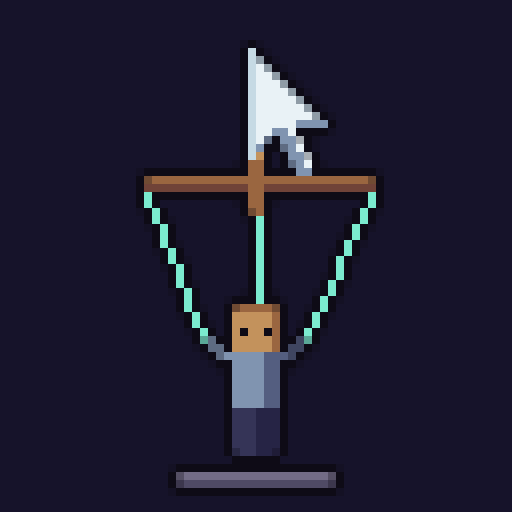
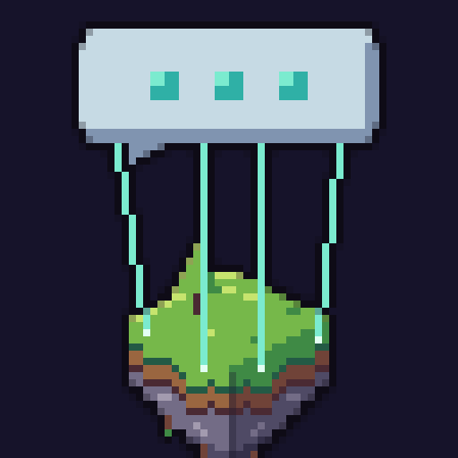
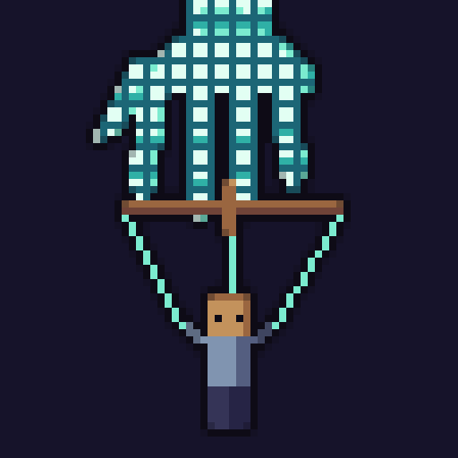
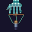
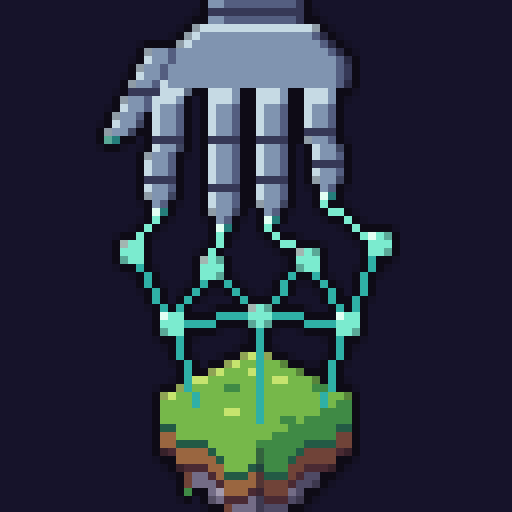
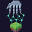
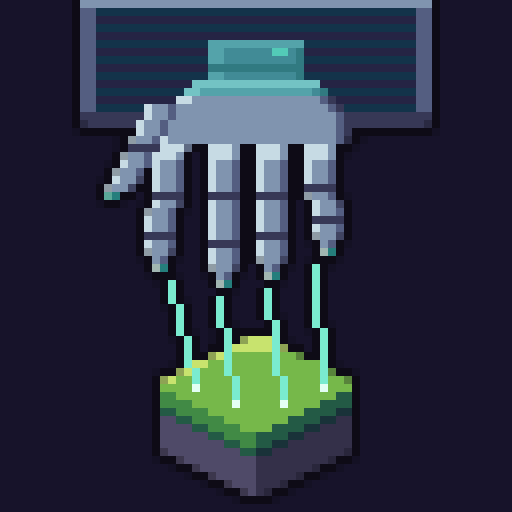

# Puppeteer variants (round three)

Artem picked the Puppeteer idea. These are five quick sketches that try to carry the AI cue through shape and light instead of letters. Sheet: [`puppeteer.png`](puppeteer.png). Single icons: `puppeteer/NN-name-64.png` (native), `-512.png` (x8) and `-32.png` (box-downscaled). Source: `scripts/brand/puppets.py`.

Blind read: one fresh `claude -p` session per variant, in an empty directory, given only that icon at 32 px and at 512 px. Question: "This is the icon of a Minecraft mod. In one or two sentences, what do you think this mod does?" This is a reading, not a gate.

## 1. Cursor

 

Cursor: the computer's own arrow pointer holds the marionette bar and works a small player.

> This mod most likely lets you control a player or another entity remotely, like a puppet on strings. The mouse cursor acting as the puppeteer's control bar suggests click-to-move or point-and-click control, or possibly controlling a second character or a fake player.

## 2. Chat bubble

 

Chat bubble: a typing chat bubble is the control bar; its strings work a floating island.

> This mod likely adds a chat or messaging feature that's tied to the world or terrain. The speech bubble with typing dots is linked by beams to a floating grass island, so it may be a chat bridge that shows in-game chat or notifications in the world, or lets players interact with chunks and islands through chat commands.

## 3. Hologram hand

 

Hologram hand: a hand made of light on a pixel grid holds the cross bar over a player.

> This mod probably lets you control or "puppeteer" players or mobs, like a marionette on strings held by a giant glowing hand. It could be a mind-control, possession or remote-control mod, or one that adds a puppet-master style item or entity.

## 4. Network strings

 

Network strings: the steel hand's strings branch into a node network that holds the island.

> This mod likely lets you remotely manipulate or move blocks and terrain. A robotic or telekinetic hand controls a grass block through glowing energy strands, so it could be a telekinesis, block-grabbing or remote-building tool.

## 5. Screen hand

 

Screen hand: a hand reaches out of a screen and works a cut-layer block on strings.

> It looks like a mod that lets you manipulate blocks remotely, like a telekinetic or robotic "hand" that picks up, moves, or places blocks from a distance. The glowing strings running from the mechanical fingers to the grass block suggest puppet-like control, which could mean extended reach for building or a remote-controlled automation arm.
