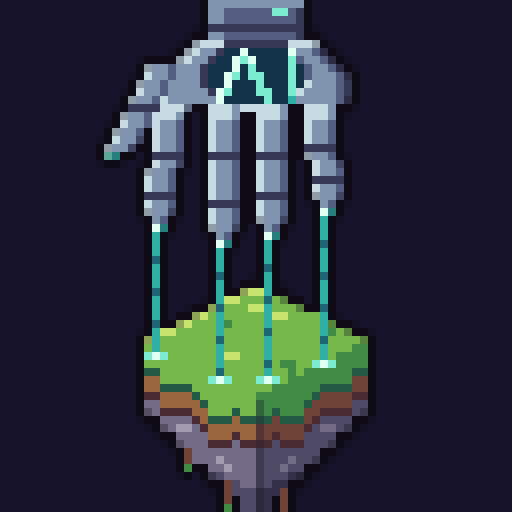
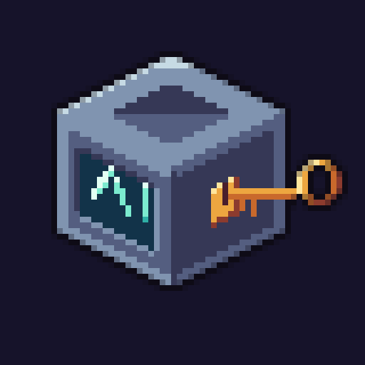
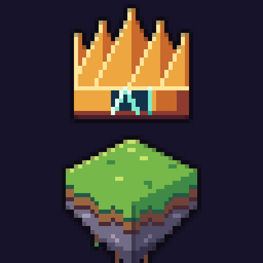
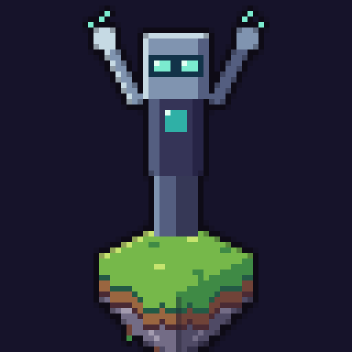
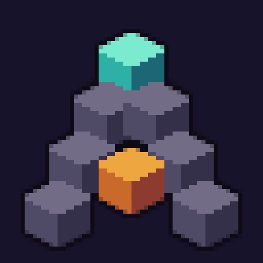
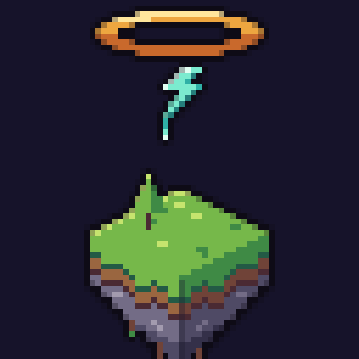

# Mark sketches, round two

Quick sketches of six different ideas for the Almighty mark. They are not full kits: Artem picks one, and only that one is developed. Sheet: [`sketches.png`](sketches.png). Single icons: `sketches/NN-name-64.png` (native) and `-512.png` (x8, nearest-neighbour). Source: `scripts/brand/marks2.py` and `art.py`, built with `python3 scripts/brand/sketches.py`.

Craft compared with round one: ramps that shift hue (violet darks, warm or cyan lights), an ink outline on the outer silhouette only with coloured inner lines, softened stair-steps on curves, and our own floating island chunk in place of a grass block. Where the agent must be named, it is a drawn ΛI monogram, not a typed label.

Blind read: one fresh `claude -p` session per sketch, run in an empty directory and shown only the 128 px icon. Question: "This is the icon of a Minecraft mod. In one or two sentences, what do you think this mod does?" This is a reading, not a gate.

## 1. Puppeteer

Puppeteer: a steel hand with the agent monogram works a floating island on strings - the agent runs the world, wired, not loose.

> A robotic or mechanical hand hangs a floating grass island from glowing strings, like a puppet. My guess is that the mod adds skyblock or floating-island features, or automation and "puppet" mechanics that control or manipulate terrain.

## 2. Keyed core

Keyed core: a command core with the agent lit inside, locked by the owner's gold key - power that only turns when the owner allows.

> This mod probably adds an AI-powered block or machine that you unlock or configure with a key. The cube is labeled "AI" and has a golden key in it, so it likely connects Minecraft to an AI service. That could mean a chatbot or an assistant that you authenticate with an API key.

## 3. Sovereign

Sovereign: a crown carrying the agent monogram hovers over the island - the agent rules the world.

> A golden crown floating above a grass block suggests a mod about ruling or owning land. It could be a land-claiming or territory protection mod, or a kingdom or faction mod where players claim chunks and hold power over them.

## 4. Avatar

Avatar: the agent as a real body, a blocky figure with a lit visor standing on the world, arms raised in power.

> A small robot with its arms raised stands on a floating grass-block island. The mod probably adds robots or automation to the game, such as helper bots that do tasks for the player, or it could be a skyblock or island-themed mod with a robot companion.

## 5. Block A

Block A: the letter A built from the world's own blocks, the apex block lit with the agent's light.

> Judging by the icon, a pyramid of stacked stone blocks topped with a teal block and an orange block, this mod probably adds new building blocks or a block-stacking or structure-generation feature. It could also be a utility mod for organizing blocks or ores, since the teal and orange blocks look like special or rare ones.

## 6. Halo strike

Halo strike: a gold halo over the island and one bolt of the agent's light striking it - power from above.

> This mod probably adds a "heaven" or sky-island dimension, with a floating grass-topped island under a halo and lightning bolt. It could also be a mod about divine powers, such as smiting with lightning or summoning weather.
