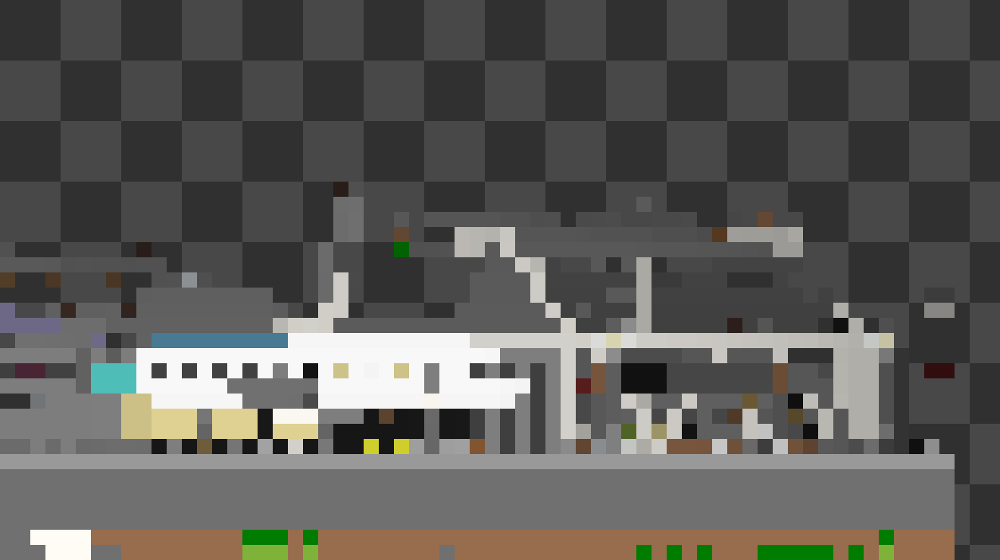

**Connect an AI agent to your Minecraft server and let it play game master: it sees the world, talks to players,
builds, runs events and plays with its own bot players. You decide how much of that power it uses, for whom and
where.**

Server-side only, players install nothing · NeoForge and Fabric · Minecraft 1.21.1, 26.1.2, 26.3 ·
[Русский](https://github.com/zentixua/almighty/blob/main/docs/store/description.ru.md)

## Infinite power, governed use

Almighty opens the whole game to the agent, from the foundation up: a player's body, an operator's power over the
world and the engine underneath. On top sits one permission system that the server owner controls. A player's
request is not an order: the agent acts with the rights of whoever asked, every change is recorded and can be undone,
and the server never stalls for it. It fits a server for three friends and a public one with hundreds of players.

## What the agent can do

### A body in the world

- **Bot players.** Server players that act only through the packets a real client sends: keys, mouse, hotbar,
  menus, chat and commands. They walk, sprint, mine, build, use chests, ride horses, boats, pigs, striders and camels,
  and fly [Immersive Aircraft](https://www.curseforge.com/minecraft/mc-mods/immersive-aircraft) planes.
- **Eyes.** A first-person picture from any player, bot, entity or free camera, with a list of what is in sight and
  under the crosshair.

### An operator's power over the world

- **Sees the server:** a top-down map drawn like a vanilla map, a box seen from any side, blocks as text, players
  with position, health, inventory and effects, entities in an area.
- **Follows the game** through an event feed: chat, joins, deaths with their cause, advancements, dimension changes,
  player commands, server stalls.
- **Talks to players** in chat, titles and the action bar. Any player can write to it privately with `/gm <text>`.
- **Runs commands and functions**, gives items, and **builds** fills and layered plans of up to two million blocks,
  placed in small portions between ticks.
- **Prepares distant places**: loads their chunks without ticking them, to look or build where nobody is.

### The engine underneath

- **Rules** on any event of the game or of any mod: run in the same tick, can cancel the event, can be saved with
  the world. A rule that overruns its time budget, keeps failing or floods the feed turns itself off.
- **Groovy scripts** on the server thread, with a deadline.
- **Learns any modpack** from the running server: blocks with their states, items, recipes, commands and events
  of every installed mod, and NeoForge config values.

## You decide how much

- **Presets.** `private` (the agent uses its full rights), `friends` (the default for a new server: unasked, it acts
  as a member would) or `public` (as a guest would). Each app you connect has its own ceiling.
- **Roles.** Owner, admin, builder, member, guest. Every capability is a permission node `almighty.<capability>`, so
  [LuckPerms](https://luckperms.net) decides when installed; without it,
  `/almighty role <player> builder 3h` gives a role for a while.
- **Requests run with the player's rights.** A command that would change things for other players waits for the
  player who asked to press **[Allow]** in chat. A request above their rights can go to an admin instead.
- **Zones.** No building at spawn; an arena where the agent may build on its own.
- **Quotas.** Blocks and items per player per hour.
- **Claims.** With [Open Parties and Claims](https://www.curseforge.com/minecraft/mc-mods/open-parties-and-claims) or FTB Chunks, a
  build for a player happens only where that player may build.
- **Content limits.** Below the owner: no command blocks, spawners or block data, no spawn eggs, plain items only.
- **Ask in words.** "Deny building at spawn" is applied at once; anything the agent proposes that grants more waits
  for the owner's confirmation. Every change keeps the previous policy file.

## Nothing happens behind your back

- **Journal and undo.** Every block the agent changes is written to disk every tick, even if the server crashes
  mid-build. Undo any change; blocks that players changed since are left alone and reported. A player gets
  "Done for you … [Undo]" after a request.
- **Audit and a red button.** Every action and every refusal goes to a daily log (`/almighty log`).
  `/almighty pause` stops one agent or all of them at once: they can only look, their builds wait, their bots stop.
- **Bots are marked.** `[bot]` in the tab list and chat; a bot cannot take a known player's name or skin unless you
  allow it.
- **The server comes first.** Agent work gets 3 ms per tick and a quarter of that while the server lags. Commands
  and scripts known to crash or freeze a server (`stop`, `forceload add`, threads, synchronous chunk loads …) are
  refused for every agent.
- **Depends on nothing.** No blocks, items or network packets of its own; other mods' support loads only when they
  are installed.

> **Security.** A connected agent is as powerful as you let it be: as an owner app it runs commands and, with
> scripts on, code on the server machine. The bridge listens only on `127.0.0.1` by default and every app signs in
> with a code you type on the server. Read [Security](https://github.com/zentixua/almighty/blob/main/docs/guide/security.md)
> before opening it to anyone else.

## Quick start

1. Put the jar for your Minecraft version and loader into the server's `mods/` folder (on Fabric, with
   [Fabric API](https://www.curseforge.com/minecraft/mc-mods/fabric-api)) and start the server.
2. Tell your agent app: `connect to my Minecraft server at http://127.0.0.1:25650/mcp`. It adds the server itself;
   `/almighty connect` in the console shows the line or link for each app.
3. The app opens a sign-in page with a four-digit code. Type `/almighty approve <code> <name> owner` in the console
   for your own app (without `owner` it may look, build, talk and drive bots, but not run commands or scripts).

Works with any MCP app: Claude Code, Codex (also in the ChatGPT desktop app), Cursor, VS Code, opencode, Gemini CLI,
Antigravity or a local model. Server on a VPS or a hosting panel:
[Hosting](https://github.com/zentixua/almighty/blob/main/docs/guide/hosting.md). Players then talk to the game
master with `/gm <text>` or just by its name.

## Versions

| Minecraft | NeoForge | Fabric | Java |
|---|---|---|---|
| 1.21.1 | 21.1.264 or newer | not available | 21 |
| 26.1.2 | 26.1.2.130 or newer | Loader 0.20.1 or newer, with Fabric API | 25 |
| 26.3 | 26.3.0.118 or newer | Loader 0.20.1 or newer, with Fabric API | 25 |

Dedicated servers. Single-player and LAN worlds start the bridge only with `bridge.integrated = true`.

## Works with

All optional; each mod's support loads only when it is installed.

| Mod | What Almighty does with it | Where |
|---|---|---|
| [Immersive Aircraft](https://www.curseforge.com/minecraft/mc-mods/immersive-aircraft) | Bots fly its aircraft with a player's controls | 1.21.1, 26.1.2 |
| [Sable](https://www.curseforge.com/minecraft/mc-mods/sable) (Create Aeronautics) | The agent reads ships: position, rotation, velocity, bounds; never builds on ship plots | 1.21.1 |
| [Open Parties and Claims](https://www.curseforge.com/minecraft/mc-mods/open-parties-and-claims) | Builds for a player only where they may build | all |
| FTB Chunks | The same, for FTB Chunks claims | 1.21.1, 26.1.2 |
| [LuckPerms](https://luckperms.net) | Decides the `almighty.*` permission nodes | all |

## For mod and datapack authors

Agents already read your blocks, items, recipes, commands, events and NeoForge config from the running server. To explain
what a catalog cannot, ship a Markdown note at `data/<namespace>/almighty/notes/<name>.md`; agents see its
description and read it when they need it. A vehicle steered by its rider's input becomes drivable by bots once it
is in the entity tag `almighty:driven_by_rider`. No dependency: without Almighty these files are unused data.
[Details](https://github.com/zentixua/almighty/blob/main/docs/guide/for-mod-authors.md).

## FAQ

**Do players need the mod?** No. It runs on the server only; vanilla clients connect as usual.

**Does it include an AI?** No. It is the bridge: you bring the agent app (its subscription or a local model). The mod
calls no AI service itself.

**Can the agent wreck my world?** It does what its rights allow. On the default `friends` preset, unasked, it acts as
a member would; a player's request runs with that player's rights. Any change can be undone from the journal, and
`/almighty pause` stops it at once.

**Will it lag my server?** Agent work is capped at 3 ms per tick and slows down further while the server lags.
Rules that overrun their budget turn themselves off.

**Can it run in single-player?** Yes, with `bridge.integrated = true` in `config/almighty-common.toml` (loopback
only).

**Can I put it in a modpack?** Yes, under GPL-3.0. It is server-side only, so mark it that way in the pack.

## Made with AI, for AI

Almighty is designed and directed by ZentixUA and written with Claude Code: the code, the documentation and this
page are written by an AI agent under the author's review. The artwork is pixel art drawn in code. The mod exists for
AI agents, and it runs on the author's own server, where an AI game master plays with friends.

## Links

[Guide](https://github.com/zentixua/almighty/blob/main/docs/guide/README.md) ·
[Source](https://github.com/zentixua/almighty) ·
[Issues](https://github.com/zentixua/almighty/issues) ·
[Changelog](https://github.com/zentixua/almighty/releases)

GPL-3.0-only. The jar bundles Groovy 4 (Apache License 2.0).
