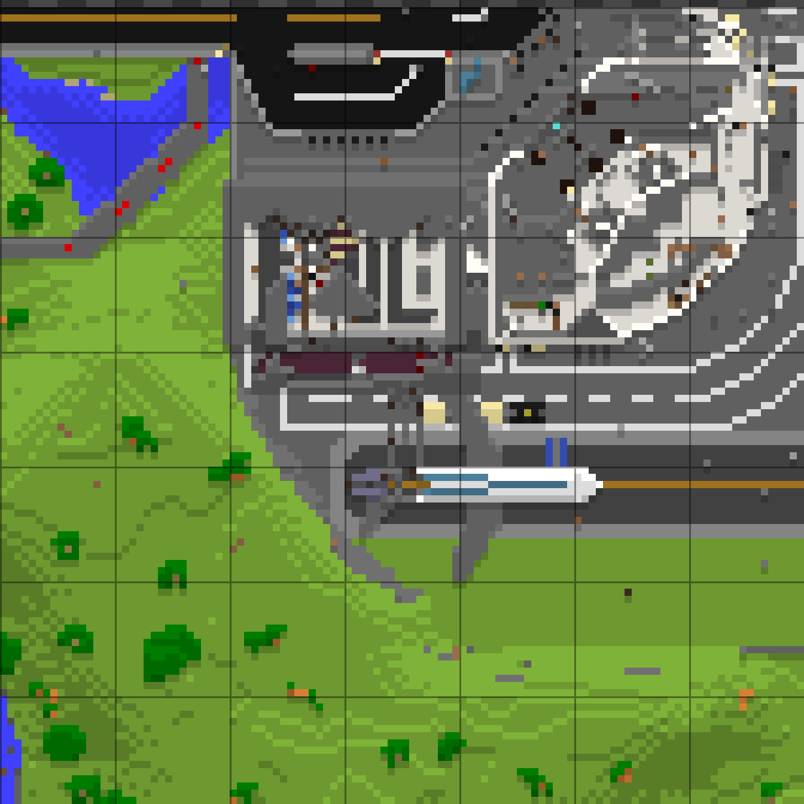
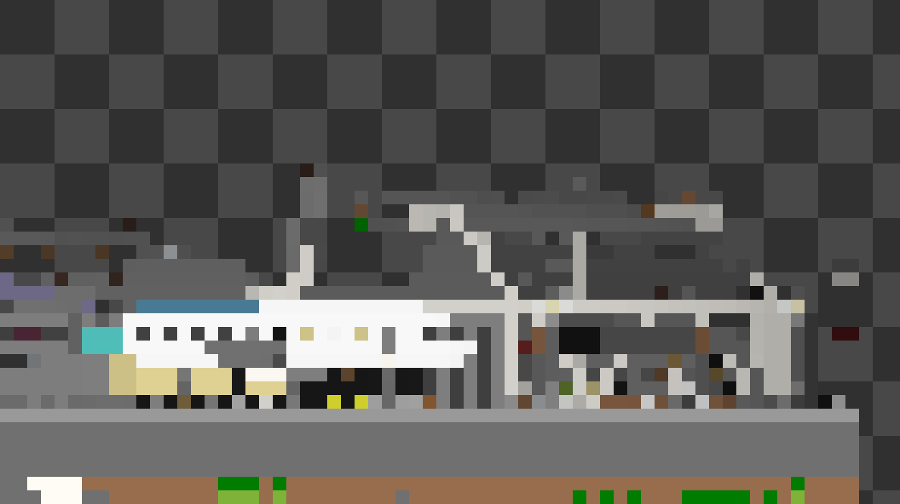

**Подключите ИИ-агента к своему серверу Minecraft, и он станет ведущим: видит мир, говорит с игроками, строит,
устраивает события и играет своими ботами. Сколько этой силы он использует, для кого и где, решаете вы.**

Только сервер, игрокам ничего ставить не нужно · NeoForge и Fabric · Minecraft 1.21.1, 26.1.2, 26.3 ·
[English](https://github.com/zentixua/almighty/blob/main/docs/store/description.md)

## Безграничная сила, управляемое применение

Almighty открывает агенту всю игру с самого основания: тело игрока, власть оператора над миром и движок под ними.
Поверх стоит одна система прав, которой управляет владелец сервера. Просьба игрока — не приказ: агент действует с
правами того, кто попросил, каждое изменение записывается и откатывается, а сервер ради агента не подвисает. Подходит
и серверу на троих друзей, и публичному на сотни игроков.

## Что может агент

### Тело в мире

- **Боты-игроки.** Серверные игроки, которые действуют только пакетами настоящего клиента: клавиши, мышь, хотбар,
  меню, чат и команды. Они ходят, бегают, копают, строят, пользуются сундуками, ездят на лошадях, лодках, свиньях,
  страйдерах и верблюдах и летают на самолётах [Immersive Aircraft](https://modrinth.com/mod/immersive-aircraft).
- **Глаза.** Картинка от первого лица из глаз любого игрока, бота, сущности или свободной камеры, со списком того,
  что видно и что под прицелом.

### Власть оператора над миром

- **Видит сервер:** карту сверху, нарисованную как ванильная, область с любой стороны, блоки текстом, игроков с
  координатами, здоровьем, инвентарём и эффектами, сущности в области.
- **Следит за игрой** по ленте событий: чат, входы, смерти с причиной, достижения, смены измерения, команды
  игроков, задержки сервера.
- **Говорит с игроками** в чате, заголовком и над хотбаром. Любой игрок может написать ему лично: `/gm <текст>`.
- **Выполняет команды и функции**, выдаёт предметы и **строит** заполнения и послойные планы до двух миллионов
  блоков, небольшими порциями между тиками.
- **Готовит далёкие места**: загружает их чанки без обновления, чтобы смотреть или строить там, где никого нет.

 

### Движок под ними

- **Правила** на любое событие игры или любого мода: срабатывают в том же тике, могут отменить событие,
  сохраняются с миром. Правило, которое превышает бюджет времени, раз за разом падает или заваливает ленту,
  выключается само.
- **Скрипты Groovy** в потоке сервера, с ограничением времени.
- **Изучает любую сборку** по работающему серверу: блоки с их состояниями, предметы, рецепты, команды и события
  каждого установленного мода, а также настройки NeoForge.

## Сколько силы — решаете вы

- **Пресеты.** `private` (агент пользуется всеми своими правами), `friends` (по умолчанию на новом сервере: по своей
  инициативе действует как участник) или `public` (как гость). У каждого подключённого приложения свой потолок.
- **Роли.** Владелец, админ, строитель, участник, гость. Каждая возможность — узел прав `almighty.<возможность>`,
  так что при установленном [LuckPerms](https://luckperms.net) решает он; без него
  `/almighty role <игрок> builder 3h` даёт роль на время.
- **Просьба выполняется с правами игрока.** Команда, которая изменит что-то для других, ждёт, пока попросивший
  нажмёт **[Allow]** в чате. Просьбу выше прав игрока может одобрить админ.
- **Зоны.** На спавне не строить; арена, где агент строит сам.
- **Квоты.** Блоки и предметы на игрока в час.
- **Приваты.** С [Open Parties and Claims](https://modrinth.com/mod/open-parties-and-claims) или FTB Chunks агент
  строит для игрока только там, где тот сам может строить.
- **Ограничения содержимого.** Ниже владельца: без командных блоков, спавнеров и данных блоков, без яиц призыва,
  только простые предметы.
- **Словами.** «Запрети строить на спавне» применяется сразу; всё, что агент предлагает сам и что расширяет права,
  ждёт подтверждения владельца. Каждое изменение сохраняет предыдущий файл политики.

## Ничего за вашей спиной

- **Журнал и откат.** Каждый блок, который меняет агент, пишется на диск каждый тик, даже если сервер упадёт посреди
  стройки. Любое изменение откатывается; блоки, которые с тех пор поменяли игроки, остаются, и о них сообщается.
  Игрок после своей просьбы получает «Done for you … [Undo]».
- **Аудит и красная кнопка.** Каждое действие и каждый отказ — в ежедневный журнал (`/almighty log`).
  `/almighty pause` останавливает одного агента или всех сразу: они только смотрят, их стройки ждут, боты стоят.
- **Боты помечены.** `[bot]` в списке игроков и в чате; бот не может взять имя или скин известного игрока, если
  вы этого не разрешили.
- **Сервер прежде всего.** Работе агента — 3 мс на тик, а пока сервер лагает, четверть от этого. Команды и
  скрипты, которые роняют или вешают сервер (`stop`, `forceload add`, потоки, синхронная загрузка чанков …),
  запрещены всем агентам.
- **Ни от чего не зависит.** Своих блоков, предметов и сетевых пакетов нет; поддержка других модов загружается,
  только если они установлены.

> **Безопасность.** Подключённый агент силён настолько, насколько вы позволили: как приложение владельца он
> выполняет команды, а при включённых скриптах — код на машине сервера. Мост по умолчанию слушает только
> `127.0.0.1`, и каждое приложение входит по коду, который вы вводите на сервере. Прочитайте
> [Безопасность](https://github.com/zentixua/almighty/blob/main/docs/guide/security.ru.md), прежде чем открывать его
> кому-то ещё.

## Быстрый старт

1. Положите jar для своей версии Minecraft и загрузчика в папку `mods/` сервера (на Fabric вместе с
   [Fabric API](https://modrinth.com/mod/fabric-api)) и запустите сервер.
2. Скажите агенту: `connect to my Minecraft server at http://127.0.0.1:25650/mcp`. Он сам добавит сервер;
   `/almighty connect` в консоли покажет строку или ссылку для каждого приложения.
3. Приложение откроет страницу входа с четырёхзначным кодом. Для своего приложения введите в консоли
   `/almighty approve <код> <имя> owner` (без `owner` оно может смотреть, строить, говорить и водить ботов, но не
   выполнять команды и скрипты).

Подходит любое приложение с MCP: Claude Code, Codex (и в настольном приложении ChatGPT), Cursor, VS Code, opencode,
Gemini CLI, Antigravity или локальная модель. Сервер на VPS или хостинге:
[Хостинг](https://github.com/zentixua/almighty/blob/main/docs/guide/hosting.ru.md). Игроки зовут ведущего
командой `/gm <текст>` или просто по имени.

## Версии

| Minecraft | NeoForge | Fabric | Java |
|---|---|---|---|
| 1.21.1 | 21.1.264 или новее | нет | 21 |
| 26.1.2 | 26.1.2.130 или новее | Loader 0.20.1 или новее, с Fabric API | 25 |
| 26.3 | 26.3.0.118 или новее | Loader 0.20.1 или новее, с Fabric API | 25 |

Выделенные серверы. В одиночной игре и в LAN мост запускается только с `bridge.integrated = true`.

## Работает с

Всё необязательно; поддержка мода загружается, только если он установлен.

| Мод | Что делает Almighty | Где |
|---|---|---|
| [Immersive Aircraft](https://modrinth.com/mod/immersive-aircraft) | Боты летают на его самолётах с управлением игрока | 1.21.1, 26.1.2 |
| [Sable](https://modrinth.com/mod/sable) (Create Aeronautics) | Агент видит корабли: положение, поворот, скорость, границы; на участках кораблей не строит | 1.21.1 |
| [Open Parties and Claims](https://modrinth.com/mod/open-parties-and-claims) | Строит для игрока только там, где тот может строить | все |
| FTB Chunks | То же для приватов FTB Chunks | 1.21.1, 26.1.2 |
| [LuckPerms](https://luckperms.net) | Решает узлы прав `almighty.*` | все |

## Авторам модов и датапаков

Агенты уже читают ваши блоки, предметы, рецепты, команды, события и настройки NeoForge с работающего сервера. Чтобы
объяснить то, чего нет в каталоге, положите заметку Markdown в `data/<namespace>/almighty/notes/<name>.md`: агенты
видят её описание и читают её, когда нужно. Транспорт, которым правит ввод седока, становится доступен ботам, если
он в теге сущностей `almighty:driven_by_rider`. Зависимости нет: без Almighty эти файлы просто не используются.
[Подробнее](https://github.com/zentixua/almighty/blob/main/docs/guide/for-mod-authors.ru.md).

## Вопросы

**Нужен ли мод игрокам?** Нет. Он работает только на сервере; обычные клиенты подключаются как всегда.

**Внутри есть ИИ?** Нет. Мод — это мост: агента приносите вы (его подписка или локальная модель). Сам мод не
обращается ни к какому ИИ-сервису.

**Может ли агент испортить мир?** Он делает то, что позволяют его права. На пресете `friends` по умолчанию по своей
инициативе он действует как участник; просьба игрока выполняется с правами этого игрока. Любое изменение
откатывается по журналу, а `/almighty pause` сразу его останавливает.

**Будет ли сервер лагать?** Работа агента ограничена 3 мс на тик и замедляется ещё сильнее, пока сервер лагает.
Правила, превысившие бюджет, выключаются сами.

**Работает в одиночной игре?** Да, с `bridge.integrated = true` в `config/almighty-common.toml` (только loopback).

**Можно в сборку?** Да, по GPL-3.0. Мод только серверный, так и отметьте его в сборке.

## Сделано с ИИ, для ИИ

Almighty придумывает и направляет ZentixUA, а пишет Claude Code: код, документацию и эту страницу пишет ИИ-агент под
проверкой автора. Графика — пиксель-арт, нарисованный кодом. Мод существует для ИИ-агентов и работает на сервере
автора, где ИИ-ведущий играет с друзьями.

## Ссылки

[Руководство](https://github.com/zentixua/almighty/blob/main/docs/guide/README.ru.md) ·
[Исходный код](https://github.com/zentixua/almighty) ·
[Ошибки и предложения](https://github.com/zentixua/almighty/issues) ·
[Список изменений](https://github.com/zentixua/almighty/releases)

GPL-3.0-only. В jar входит Groovy 4 (Apache License 2.0).
